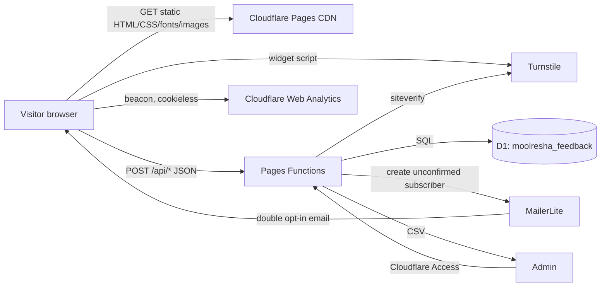
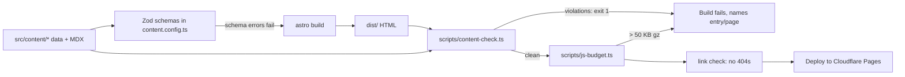
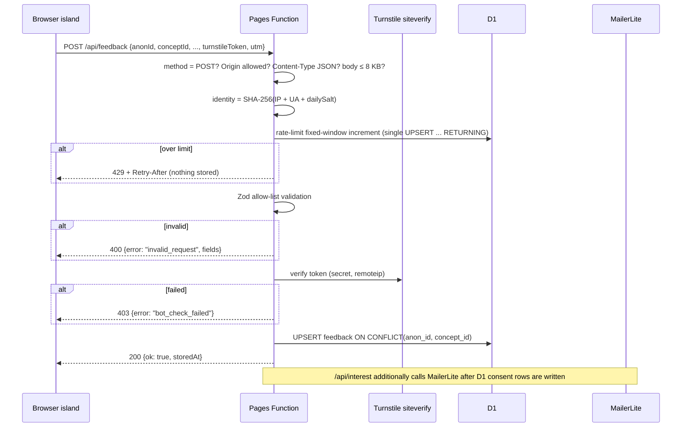
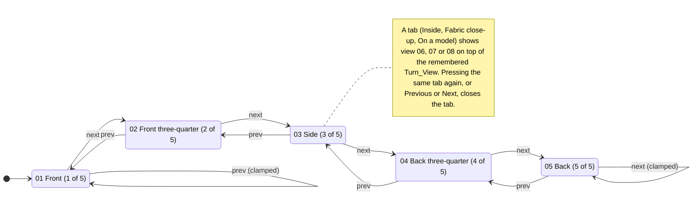
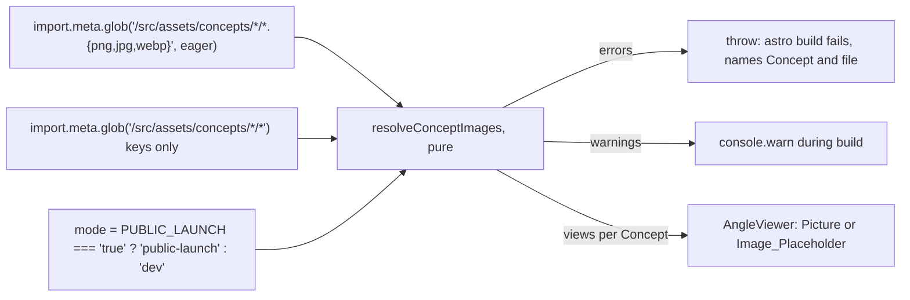

# Design Document: launch-feedback-website

## Overview

This design turns the existing `moolresha-web` Astro site (separate repo at `/Users/srathore/code/frontend/moolresha-web`) into a launch website for feedback collection. It is static-first. Every content section is pre-rendered HTML and CSS at build time. A small set of Cloudflare Pages Functions accepts writes (Concept feedback, frustrations, interest, event counts) and serves cached aggregate results. D1 is the only database.

The design has four parts:

1. **Content and integrity layer (build time).** Facts, Concepts (including each Concept's Quality_Card rows and per-view alt text), Price_Bands, Price_Layers and Market_Price_Context live in typed Astro content collections validated by Zod. Concept_View images are read from fixed file names in `src/assets/concepts/<Concept_ID>/` by a build-time loader that warns about missing files in development and fails a Public_Launch_Build. A Content_Check script runs after `astro build` over the data and the rendered HTML. It fails the build when an integrity rule is broken (missing Claim_Label or source, unverified facts, greenwashing words, "European linen", a brand name on any page, gapped Price_Bands, a ₹ amount inside the Price_Layers section outside the GST fact, a restricted story phrase outside a sourced fact, a broken Quality_Card label rule, an unconfirmed exact yarn count or GSM, or a Health_Term_List word anywhere).
2. **Presentation layer.** One Launch_Page with sections in the order fixed by Requirement 2.1, a Privacy_Notice page, the Journal and a footer. All content renders without JavaScript. Small vanilla-TypeScript islands add progressive enhancement: the feedback forms, the Angle_Viewer, the Interest_Form, the Results_View and the event counter. The total first-load JS budget is 50 KB compressed (Requirement 20.2).
3. **Write layer (Pages Functions).** POST-only JSON endpoints under `/api/`. Each request passes the same pipeline: method and Origin check, body-size cap, rate limit, Zod allow-list validation, Turnstile verification (for feedback, frustration and interest writes), then a D1 write. Shared helpers live in `functions/_shared/`, as `docs/rate-limiting.md` requires.
4. **Admin layer.** CSV export endpoints behind Cloudflare Access (with a bearer secret as fallback), and a documented deletion procedure covering D1 and MailerLite.

### Key design decisions

| Decision | Choice | Rationale |
|---|---|---|
| Storage for writes | **D1** for feedback, frustrations, interest, consents, event counts **and** rate-limit counters | The Workers Free plan allows 1,000 KV writes per day ([Cloudflare blog](https://blog.cloudflare.com/workers-kv-free-tier)). A fixed-window counter writes once per request, so KV would cap the whole site at roughly 1,000 writes a day. D1 Free allows 100,000 rows written per day ([D1 pricing](https://developers.cloudflare.com/d1/platform/pricing/); figure as reported by [dev.to](https://dev.to/alexcodebytes/how-cloudflare-d1s-daily-write-limit-almost-broke-my-sanctions-app-and-how-i-fixed-it-4b06), ⚠️ re-verify at build time). Since 1 Sep 2026, D1 queries on the Free plan fail once the daily limit is exceeded and recover at midnight UTC ([Cloudflare changelog](https://sync-log-fields-2026-09-01.previews.developers.cloudflare.com/changelog)). **KV is not used.** |
| Rate limiter backend | Fixed-window counter in a D1 `rate_limits` table, behind a `RateLimitStore` interface | Keeps `docs/rate-limiting.md` semantics (hashed identity, fixed window, 429 + `Retry-After`). The Workers Rate Limiting binding only supports 10 s or 60 s periods and keeps counters per Cloudflare location, eventually consistent ([community answer](https://community.cloudflare.com/t/are-workers-rate-limiting-api-bindings-free-on-the-workers-free-plan/971323/2)). It can be added later as a cheap first layer that does not use D1 writes, but it is not the system of record. |
| Bot check | Turnstile, verified server-side on every feedback, frustration and interest write | A token lasts five minutes and can be validated only once. Replays return `timeout-or-duplicate` ([Turnstile docs](https://github.com/cloudflare/cloudflare-docs/blob/production/src/content/docs/turnstile/get-started/server-side-validation.mdx)). The island therefore fetches a fresh token per submission. |
| Event counter bot check | No Turnstile; rate limit plus Origin check only | Event counts carry no personal data and are low-value to attackers. A Turnstile challenge on every section view would cost JS and add friction. Requirement 18.5 asks only for rate limiting. |
| Email | MailerLite `POST /api/subscribers` with `status: "unconfirmed"` into a single group that has double opt-in on | MailerLite creates or updates a subscriber by email without destroying existing data, and supports the `unconfirmed` status ([MailerLite API](https://developers.mailerlite.com/docs/subscribers)). Double opt-in for API sign-ups is an account setting ([MailerLite classic API](https://developers-classic.mailerlite.com/reference/change-double-optin-status)). ⚠️ verify on the account that an API-created `unconfirmed` subscriber receives the confirmation email before launch. |
| Deletion at MailerLite | `POST /api/subscribers/:id/forget` | Deletes all subscriber data within 30 days ([MailerLite API](https://developers.mailerlite.com/docs/subscribers)). Plain `DELETE` keeps data in case of re-subscription, so it does not meet a deletion request. |
| Anonymous_ID | `crypto.randomUUID()` (UUID v4, 122 random bits) in `localStorage` | Meets Requirement 15.1 directly. `localStorage` is not sent with requests, so it is not a cookie and needs no banner. The ID travels only in POST bodies. |
| Analytics | Cloudflare Web Analytics (cookieless beacon) plus our own D1 day-level counters | Requirement 18.1. No cookies, so no banner. |
| Client JS | Vanilla TypeScript islands, no UI framework | A framework runtime alone would use much of the 50 KB budget. The forms are plain HTML forms that the island enhances. |
| Garment views | A fixed set of eight images per Concept in an own-code Angle_Viewer (pointer drag and swipe, buttons, arrow keys, CSS crossfade). No 3D viewer, spin library or carousel library | Round 8 parks `<model-viewer>` (it needs a GLB file, and ChatGPT produces flat images) and frame-sequence spins (AI images drift between frames, which looks fake). Pointer events give one code path for mouse, pen and touch ([MDN Pointer events](https://developer.mozilla.org/en-US/docs/Web/API/Pointer_events)). The viewer logic is a pure state module, so it is small (about 3 KB gzip with the DOM glue) and testable without a browser (Requirement 8A.15). |
| Image intake | Astro `import.meta.glob` over `src/assets/concepts/*/` with eight fixed base names, resolved by a pure function | Vite's glob import lets the build find whatever files exist without a code change, and Astro's `<Picture>` then optimises them ([Astro: dynamically import images](https://docs.astro.build/en/recipes/dynamically-importing-images/)). The founder can drop or replace a file and rebuild (Requirement 8B.3). |
| The three view tabs | Styled as tabs, built as three toggle buttons (`<button aria-pressed>`) labelled "Inside", "Fabric close-up" and "On a model", not the ARIA `tablist` pattern | An ARIA tab list always has one selected tab and moves between tabs with Left and Right Arrow ([WAI-ARIA APG, Tabs](https://www.w3.org/WAI/ARIA/apg/patterns/tabs/)). The Angle_Viewer has a state where none of the three is selected (a Turn_View is shown), and Left and Right Arrow already turn the garment (Requirement 8A.5). Toggle buttons look like tabs, are reached with Tab and pressed with Enter or Space, and give each key one meaning. |
| Priority_Chips storage | `priorities TEXT` holding the sorted, `\|`-joined chip ids; counts are summed in code after a `GROUP BY concept_id, priorities` | See Results aggregation. Same storage shape as Change_Chips, one parser for D1 rows and the CSV, and a result set bounded by the number of chip combinations rather than the number of responses. |
| Results | Aggregates computed in SQL, cached for 5 minutes with the Cache API and `Cache-Control: public, max-age=300` | Keeps D1 reads low and gives visitors a "last computed" time (Requirement 16.4). |
| Admin auth | Cloudflare Access on `/api/admin/*` (primary), constant-time bearer-secret check (fallback and defence in depth) | Requirement 17.1. Access needs no code. The bearer check covers preview deployments and local runs. |

### Research notes that shape the design

- Free-tier limits above come from Cloudflare documentation and blog posts seen in Nov 2026. They change often, so the launch checklist re-checks them.
- The Turnstile secret, MailerLite key, admin bearer secret and identity salt seed are Cloudflare secrets (Requirement 14.8).
- MailerLite's API cannot reactivate subscribers who unsubscribed, bounced or were marked junk ([MailerLite API](https://developers.mailerlite.com/docs/subscribers)). The interest endpoint treats this as success for the visitor and logs only the status code.
- Content decisions come from the research plan's rounds 4 to 8 (a later round overrides an earlier one where they differ). AI try-on is parked. No brand is named. Each Concept has its own Price_Bands in ₹500 steps. The price answer is a band choice or an explicit skip, never typed. The site shows no MoolResha price and no ₹ cost totals: the cost section is Price_Layers with plain explanations and a launch promise. Market context is an unnamed range shown inside each Concept_Card only after the price question is answered or skipped. The GST cliff at ₹2,500 is shown as a `FACT` with a PIB source.
- **Anchoring.** Showing a reference price before asking what someone would pay pulls their answer towards that number, even when the number is known to be irrelevant ([Ariely, Loewenstein and Prelec 2003, "Coherent arbitrariness"](https://web.mit.edu/ariely/www/MIT/Papers/CA.pdf)) — STRONG for the effect existing. Later replications find the effect smaller and less reliable than first reported ([Journal of the Economic Science Association, 2025](https://resolve.cambridge.org/core/journals/journal-of-the-economic-science-association/article/on-the-effect-of-anchoring-on-valuations-when-the-anchor-is-transparently-uninformative/7292F70B66FF6B215626C1EA66893B0A)) — MODERATE. Market prices are an informative anchor, not a random one, so the risk to our data is higher than in those studies. The design therefore holds back each Concept's Market_Price_Context until that Concept's price question has been answered or skipped, and removes any ₹ figure from the Price_Layers section above the Concepts (other than the sourced GST threshold, which is a tax fact and not a price for a garment). The Price_Band labels themselves are a fixed ladder shown to everyone, so they shape answers equally across visitors.
- **Garment presentation (rounds 7 and 8).** Round 7 proposed CLO 3D, `<model-viewer>` and a turntable spin. Round 8 replaces that with free ChatGPT images in a fixed set of views, so CLO 3D, `<model-viewer>` and 360° spins are out of scope for v1. Shoppers notice when imagery gets fit, fabric or details wrong ([Stylitics shopper survey](https://stylitics.com/resources/blog/ai-fashion-photography/), vendor survey, WEAK–MODERATE), so every view carries the Render_Label and the viewer shows no fit or strain maps (Requirement 8A.16). The image prompts are written after the web build. Until the files exist, each view shows the Image_Placeholder.
- **Quality_Card (round 7 §S, approved in round 8).** Seven rows, each with one Quality_Label. "Skin-friendly" and "hypoallergenic" read as health claims, so they sit on the Health_Term_List. Exact yarn count and GSM appear only once the mill confirms them and a `FACT` entry exists.
- **Touch gestures.** A browser that starts handling a touch gesture itself sends `pointercancel` to the page. Declaring `touch-action: pan-y` on the viewer image lets the page keep vertical scrolling while the viewer receives horizontal drags ([MDN touch-action](https://developer.mozilla.org/Web/CSS/touch-action)). `setPointerCapture` keeps the drag's events on the viewer if the pointer leaves it ([MDN setPointerCapture](https://developer.mozilla.org/en-US/docs/Web/API/Element/setPointerCapture)).

## Architecture

### System context



### Build pipeline



`package.json` scripts:

```json
{
  "scripts": {
    "build": "astro build && tsx scripts/content-check.ts && tsx scripts/js-budget.ts && tsx scripts/link-check.ts",
    "test": "vitest --run",
    "check": "astro check && tsc --noEmit -p functions"
  }
}
```

Cloudflare Pages runs `npm run build`, so a failed Content_Check stops the deploy. The Concept image loader runs inside `astro build` (see Concept image pipeline). Its warnings print during the build, and its errors (a duplicate base name in any build, a missing file in a Public_Launch_Build) throw, which fails `astro build` before Content_Check runs. `scripts/launch-gate.ts` runs only when `PUBLIC_LAUNCH=true` and checks the launch checklist records (Requirements 8B.10, 19.5). CI (`.github/workflows/ci.yml`) runs `npm ci`, `npm run check`, `npm test` and `npm run build` on every pull request.

### Write request pipeline



Order matters. The rate limit runs before validation and Turnstile, so floods cost one D1 write and no siteverify call. Validation runs before Turnstile, so malformed bodies do not use up a token check. Nothing is stored until every check passes (Requirements 14.2, 14.4).

### Repository layout (additions to `moolresha-web`)

```
src/
  content.config.ts            # existing articles + new collections below
  content/
    facts/*.yaml               # Fact_Registry entries (one file per fact)
    concepts/*.yaml            # five Concepts
    price-layers/price-layers.yaml  # ordered layers + launch promise, no amounts
    story/story.yaml           # Lead_Message and Aim_Statement copy
    market-scans/*.yaml        # one per Concept, with private evidence trail
    trends/*.yaml
    config/brand-blocklist.yaml
    config/word-rules.yaml     # greenwashing words, phrase rules, superlatives, restrictedPhrases, healthTerms
    config/allow-lists.ts      # single source for chips, colours, sizes, priorities (shared with functions)
  assets/
    concepts/<Concept_ID>/     # 01-front … 08-on-model (.png | .jpg | .webp), dropped in by the founder
  components/launch/
    Hero.astro  ResearchNotice.astro  CottonJourney.astro  JourneyStop.astro
    AimStatement.astro  MoneyBreakdown.astro  PriceLayers.astro  MarketPriceContext.astro
    ConceptsSection.astro  ConceptCard.astro  FabricNotes.astro  ConceptFeedbackForm.astro
    AngleViewer.astro  ConceptViewImage.astro  ImagePlaceholder.astro  RenderLabel.astro
    QualityCard.astro  HowWeCheck.astro
    WhyItMatters.astro  Trends.astro  TrendCard.astro  FrustrationForm.astro
    InterestForm.astro  ResultsView.astro
    FactText.astro  ClaimLabel.astro  SourceLink.astro  LastUpdated.astro
  islands/
    anon-id.ts  api-client.ts  feedback-island.ts  market-reveal.ts  interest-island.ts
    results-island.ts  events-island.ts  turnstile-loader.ts
    angle-viewer-state.ts  angle-viewer-island.ts
  lib/
    facts.ts  price-bands.ts  text-match.ts  aggregate.ts  csv.ts
    concept-images.ts          # import.meta.glob loader (Astro side)
    concept-image-resolver.ts  # pure resolver: files → views, warnings, errors
    quality-card.ts            # pure Quality_Card rule checks (used by Zod and CC-18/CC-19)
  pages/
    index.astro  privacy.astro  journal/…  (hubs: noindex, unlisted)
  styles/tokens.css  fonts.css
functions/
  _shared/  origin.ts  identity.ts  rate-limit.ts  turnstile.ts  validate.ts
            schemas.ts  respond.ts  log.ts  mailerlite.ts  db.ts  admin-auth.ts
  api/feedback.ts  api/frustration.ts  api/interest.ts  api/events.ts  api/results.ts
  api/admin/export/feedback.csv.ts  api/admin/export/aggregate.csv.ts
migrations/0001_init.sql
scripts/content-check.ts  scripts/js-budget.ts  scripts/link-check.ts  scripts/launch-gate.ts
docs/deletion-procedure.md  docs/launch-checklist.md  docs/rate-limiting.md (existing)
```

`src/content/config/allow-lists.ts` is plain TypeScript with no Astro imports. Both the site build and `functions/_shared/schemas.ts` import it, so the client options and the server allow-list cannot drift.

## Components and Interfaces

### Page structure and section order

`src/pages/index.astro` composes sections in the order Requirement 2.1 fixes. A unit test reads the built `dist/index.html` and asserts the order of `data-section` attributes.

| # | `data-section` | Component | Notes |
|---|---|---|---|
| 1 | `hero` | `Hero.astro` | Wordmark, one headline, one supporting line, one real fabric photograph (`fetchpriority="high"`, not lazy), one CTA `<a href="#concepts">`. `ResearchNotice` ("A research project, not a shop") sits directly below, within two mobile screen heights. |
| 2 | `journey` | `CottonJourney.astro` → `JourneyStop.astro` ×8, then `AimStatement.astro` | An ordered list (`<ol>`). Each stop is a `<details open>` element, so its Fact is readable without hover or JS (Requirement 4.5). Stops: field, ginning, spinning, weaving, processing, stitching, warehousing and distribution, retail. Countries other than India appear only inside sourced `FACT` elements in neutral journey terms (Requirement 4.6). Directly after the `</ol>`, `AimStatement` renders the Aim_Statement as plain copy (see Story framing below). |
| 3 | `money` | `MoneyBreakdown.astro` | The section `<h2>` is the Lead_Message. Below it: a CSS-only horizontal bar chart with a visible value label on each bar, plus a `<table>` of the same values, labelled as a European example with a Source_Link. Any farmer or worker share is a `FactText` (Requirement 5.6). |
| 4 | `price-layers` | `PriceLayers.astro` | An ordered list of the nine layers, each with its name and one-line explanation, and no amounts. The launch promise follows the list. GST context is a `FactText` with a PIB source. |
| 5 | `concepts` | `ConceptsSection.astro` → `ConceptCard.astro` ×5, then `HowWeCheck.astro` | The cotton shirt comes first and spans the full grid width. Each card has an `AngleViewer`, `FabricNotes`, a `QualityCard`, a `ConceptFeedbackForm` and, after the price question, that Concept's `MarketPriceContext` (see the sections below). `HowWeCheck` is a short `<section id="how-we-check">` inside `concepts`, after the last card, that every Quality_Card links to. It is not a separate `data-section`, so the Requirement 2.1 order is unchanged. |
| 6 | `why` | `WhyItMatters.astro` | Softness, easy care, how long clothes last. Every Fact comes from the Fact_Registry. |
| 7 | `trends` | `Trends.astro` → `TrendCard.astro` ×3–5 | One sourced Fact per card. |
| 8 | `frustration` | `FrustrationForm.astro` | Checkbox group plus an optional "other" text field. |
| 9 | `interest` | `InterestForm.astro` | Notice before fields, optional fields, separate unticked consents, 18+ confirmation, link consent. |
| 10 | `results` | `ResultsView.astro` | Server-rendered "Results load here" placeholder plus a `<noscript>` link to `/api/results` in readable form. The island fills it in. |
| 11 | `footer` | existing `Footer.astro`, extended | "MoolResha studio, Indore", contact email, Privacy_Notice link, Grievance_Contact, "A research project, not a shop", Journal link, entity name and address when one exists. |

There is no standalone market-context section (Requirement 2.2). CC-15 fails the build if the page has any `data-section` value outside the list above, and CC-16 fails it if a `MarketPriceContext` element sits outside its Concept_Card.

### Story framing (Lead_Message and Aim_Statement)

Both sentences live in `src/content/story/story.yaml` so copy edits do not touch components:

```yaml
leadMessage: "Most of what you pay for a shirt goes to the layers between the field and you."
aimLabel: "Our aim"
aimStatement: "Our aim: grown, spun, woven and stitched in India, with every step shown."
```

- `MoneyBreakdown.astro` renders `leadMessage` as the section's `<h2>` (Requirement 5.5).
- `AimStatement.astro` renders `<p class="aim" data-aim><strong>{aimLabel}</strong> …</p>` directly after the journey list (Requirement 4.7). It is ordinary copy: it never uses `FactText`, carries no Claim_Label and has no `data-fact-id`. The visible label "Our aim" is what tells the reader it is an aim and not a Fact (Requirement 11A.2). A unit test checks that `[data-aim]` is the next element sibling of the journey `<ol>`, contains the text "Our aim", and has no `.fact` ancestor or descendant.
- Copy that Round 6 removed (imports reducing India's GST, calls to choose Indian brands over Bangladesh-made clothes) is guarded by the Restricted_Phrase_List and CC-17. Requirements 11A.3 and 11A.4 go beyond any fixed phrase list, so editorial review covers them as well (see Not automated).

### Price_Layers section (`PriceLayers.astro`)

The component renders `src/content/price-layers/price-layers.yaml` (schema under Data Models):

```html
<section data-section="price-layers" aria-labelledby="price-layers-h">
  <h2 id="price-layers-h">What goes into a price</h2>
  <ol class="price-layers">
    <li data-layer="fabric"><strong>Fabric</strong> <span>{explanation}</span></li>
    … one <li> per layer, in configured order …
  </ol>
  <p class="launch-promise">When we launch, we'll publish the real cost breakdown of every piece.</p>
  <FactText id="gst-cliff-2025" />   <!-- the only place a ₹ amount may appear in this section -->
</section>
```

- The layer order is fixed by the schema (Requirement 6.1). The heading text above is a placeholder for the founder's copy.
- Nothing in the component computes or prints money. There is no MoolResha estimate, no percentage of a MoolResha price, no subtotal and no total (Requirement 6.3).
- CC-08 scans the rendered `[data-section=price-layers]` subtree for ₹ amounts and allows them only inside the GST `.fact` (Requirement 6.7). CC-11 covers offer, buy and discount wording in this section (Requirement 6.5).

### Market_Price_Context inside the Concept_Card

Each `ConceptCard` renders, in this order: name and "Concept, not for sale", `AngleViewer`, `FabricNotes`, `QualityCard` (Requirement 8.8), the verdict, Change_Chip, colour and Priority_Chip groups, the price question (Price_Band radios plus the "Skip this question" control), the submit control and live region, then `MarketPriceContext` for that Concept.

**Why it comes after the price question.** Seeing a market range first would pull the visitor's band choice towards it (see Anchoring under Research notes). The price question exists to learn what people would pay once they know what goes into the garment, so the market range is held back until that Concept's price answer, or the explicit skip, is stored. After that, showing it costs nothing for the data and gives the visitor the comparison Requirement 7 promises. The reveal is per Concept, so answering the shirt does not reveal the pant's range.

**Server-rendered markup (works without JS).** `MarketPriceContext` renders a native disclosure, collapsed by default:

```html
<details class="market-context" data-market-for="mens-cotton-shirt" data-reveal="pending">
  <summary>See what similar pieces cost</summary>
  <span class="fact" data-fact-id="market-mens-cotton-shirt">
    Similar pieces from popular brands online and in malls: about ₹X–Y
    <ClaimLabel label="MoolResha market scan"/> <MethodNote …/>
  </span>
  <p>Prices vary within every brand and change often.</p>
</details>
```

Without JS, the visitor sees the closed `<details>` below the price question and opens it only by choice (Requirement 7.5). The `<summary>` is natively keyboard-operable (Requirement 21.2). Content stays in the HTML, so no-JS visitors and Content_Check both see it (Requirement 22.1).

**With JS (`feedback-island.ts`).** On start-up the island sets `hidden` and `data-reveal="hidden"` on each `.market-context` whose Concept is not yet answered. The Concepts sit well below the first viewport and the range is inside a closed `<details>`, so a visitor will not normally see it before the deferred module runs. The design deliberately does not hide the range with an early inline script plus CSS: if the island then failed to load, the range would stay hidden for good, which breaks Requirement 7.5. The island then:

1. Reads `mr_price_answered` from `sessionStorage` and `localStorage`. This is a JSON array of Concept ids whose stored feedback contains a Price_Band or a Price_Skip. It is written only after a `200` from `/api/feedback`.
2. For each Concept in that list, reveals at once: removes `hidden`, sets `open` on the `<details>` and `data-reveal="shown"` (Requirement 7.4).
3. On a `200` from `/api/feedback` whose request carried `priceBandId` or `priceSkipped: true`, adds the Concept to `mr_price_answered` in both storages and reveals that card's range the same way. Focus is not moved. The card's live region adds "Similar pieces' prices are now shown below." so screen-reader users know new content appeared (Requirement 7.3, 21.5).
4. On an error response, or a `200` for feedback with no price answer, does not reveal.

The decision itself is a pure module, `src/islands/market-reveal.ts`, so it can be tested without a DOM:

```ts
export type PriceAnswer = 'band' | 'skip' | 'none';
export interface SubmitOutcome { conceptId: ConceptId; ok: boolean; price: PriceAnswer } // ok = HTTP 200 from /api/feedback
export function parseAnswered(raw: string | null): Set<ConceptId>;   // bad JSON, non-arrays and unknown ids are ignored
export function serialiseAnswered(s: Set<ConceptId>): string;        // sorted JSON array of ids
export function nextAnswered(s: Set<ConceptId>, o: SubmitOutcome): Set<ConceptId>; // adds o.conceptId iff o.ok && o.price !== 'none'
export function shouldReveal(conceptId: ConceptId, s: Set<ConceptId>): boolean;    // s.has(conceptId)
```

The island builds the start set as `parseAnswered(session) ∪ parseAnswered(local)`, folds each submission outcome through `nextAnswered`, writes the result back to both storages and calls `shouldReveal` per card. The set only grows. A later resubmission without a price answer does not hide a range the visitor has already seen, because hiding it again would not undo any anchoring.

The reveal flag stores only Concept ids, never answers, and sits under the same browser storage the Privacy_Notice already describes for the Anonymous_ID. If both storages are blocked, the reveal still happens after a successful submission during that page view. A returning visitor whose storage was cleared also has a new Anonymous_ID, so "answered from this Anonymous_ID" and the stored flag stay consistent. The server does not expose a per-ID lookup for this, so no endpoint can be used to probe another visitor's answers.

Hiding the range on the client is a presentation choice, not a secret: the range is a public, sourced figure that is in the HTML for no-JS visitors anyway.

The header keeps the wordmark and links only to in-page anchors, Journal and Privacy. Hub_Pages are removed from navigation, given `<meta name="robots" content="noindex">`, and filtered out of the sitemap with the `@astrojs/sitemap` `filter` option.

### Angle_Viewer (`AngleViewer.astro` + `angle-viewer-island.ts`)

The Angle_Viewer shows a Concept's eight Concept_Views. Visitors move through the five Turn_Views (front → front three-quarter → side → back three-quarter → back) and open the inside, fabric close-up and on-a-model views with three tab-style buttons. It is built with the site's own code. There is no 3D, 360° spin or carousel library (Requirement 8A.15).



**View names.** `src/lib/concept-views.ts` is the one list of views, shared by the image resolver, the content schema, the state module and the components:

```ts
export const TURN_VIEWS = ['01-front', '02-front-three-quarter', '03-side', '04-back-three-quarter', '05-back'] as const;
export const TAB_VIEWS  = ['06-inside', '07-fabric-closeup', '08-on-model'] as const;
export const VIEW_BASES = [...TURN_VIEWS, ...TAB_VIEWS] as const;   // also the eight file base names (Req 8B.2)
export const VIEW_NAMES: Record<ViewBase, string> = {
  '01-front': 'Front', '02-front-three-quarter': 'Front three-quarter', '03-side': 'Side',
  '04-back-three-quarter': 'Back three-quarter', '05-back': 'Back',
  '06-inside': 'Inside', '07-fabric-closeup': 'Fabric close-up', '08-on-model': 'On a model',
};
```

**Pure state module (`src/islands/angle-viewer-state.ts`).** All viewer logic lives here, with no DOM access, so it can be property-tested:

```ts
export interface ViewerState { turn: 0 | 1 | 2 | 3 | 4; tab: TabView | null } // turn = index into TURN_VIEWS
export const INITIAL: ViewerState = { turn: 0, tab: null };

export function next(s: ViewerState): ViewerState;       // { turn: min(turn + 1, 4), tab: null }
export function prev(s: ViewerState): ViewerState;       // { turn: max(turn - 1, 0), tab: null }
export function goto(s: ViewerState, v: ViewBase): ViewerState;
  // Turn_View → { turn: its index, tab: null }; tab view → { turn: s.turn, tab: v }
export function toggleTab(s: ViewerState, t: TabView): ViewerState;
  // s.tab === t → { turn: s.turn, tab: null }; otherwise { turn: s.turn, tab: t }
export function shown(s: ViewerState): ViewBase;         // s.tab ?? TURN_VIEWS[s.turn]
export function canPrev(s: ViewerState): boolean;        // s.tab !== null || s.turn > 0
export function canNext(s: ViewerState): boolean;        // s.tab !== null || s.turn < 4
export function positionText(s: ViewerState): string;    // "Side, 3 of 5"; for a tab, its name: "Inside"
export function hintView(s: ViewerState): TurnView | null; // next Turn_View, or null at 05 and while a tab is shown
export function dragOutcome(dx: number, dy: number, threshold: number): 'next' | 'prev' | null;
  // horizontal only: |dx| ≥ threshold and |dx| > |dy|; dx < 0 → 'next', dx > 0 → 'prev'
export function keyOutcome(key: string): 'next' | 'prev' | null; // 'ArrowRight' → next, 'ArrowLeft' → prev
```

Design choices in the state module:

- **Clamping, not wrapping.** At 01, `prev` returns the same state, and at 05, `next` does. The garment turns from front to back and stops, which matches Requirement 8A.6. Wrapping from back to front would look like a jump, because there is no view between 05 and 01.
- **Tabs do not move the turn.** A tab is shown over the remembered Turn_View. Opening and closing tabs never changes `turn`, so a visitor who looks inside from the side view returns to the side view. Previous and Next act from the remembered turn and close the tab.
- **Swipe direction.** Swiping or dragging left shows the next view, as in a photo gallery, and right shows the previous one. One gesture moves one step. A continuous scrub would need many frames, which round 8 rules out.
- **Drag threshold.** The island passes `threshold = max(24, 0.08 × stage width)` CSS pixels, so a tap or a small wobble does not turn the garment.

**Server-rendered markup (works without JS, Requirement 8A.11).** `AngleViewer.astro` takes the Concept and its resolved views (see Concept image pipeline) and renders:

```html
<div class="angle-viewer" data-angle-viewer data-concept-id="mens-cotton-shirt">
  <div class="av-stage" role="group" tabindex="0"
       aria-label="Men's 100% cotton shirt: views. Use the Left and Right Arrow keys to turn it.">
    <figure class="av-frame" data-view="01-front" data-current>
      <ConceptViewImage view="01-front" … />            <!-- <picture>, or the Image_Placeholder -->
      <figcaption><RenderLabel /></figcaption>          <!-- only when kind = render (Req 8A.12) -->
    </figure>
    <span class="av-hint" aria-hidden="true" hidden></span>
  </div>
  <p class="av-position" aria-live="polite" hidden>Front, 1 of 5</p>
  <div class="av-controls" hidden>
    <button type="button" data-av="prev" aria-disabled="true">Previous view</button>
    <button type="button" data-av="next">Next view</button>
    <div role="group" aria-label="More views">
      <button type="button" data-av-tab="06-inside" aria-pressed="false">Inside</button>
      <button type="button" data-av-tab="07-fabric-closeup" aria-pressed="false">Fabric close-up</button>
      <button type="button" data-av-tab="08-on-model" aria-pressed="false">On a model</button>
    </div>
  </div>
  <template data-av-frames>                             <!-- frames 02–08 for the stage; inert until the island runs -->
    <figure class="av-frame" data-view="02-front-three-quarter" hidden> … </figure>
    …
  </template>
  <ul class="av-grid" aria-label="All views of the men's 100% cotton shirt">
    <li><figure><ConceptViewImage view="01-front" size="thumb" … /><figcaption>Front · <RenderLabel /></figcaption></figure></li>
    … one <li> per view, 01 to 08, in order, each with its view name …
  </ul>
</div>
```

- Without JS, the visitor sees the front view large, then a grid of all eight views with their names and the Render_Label. The position indicator and the controls have `hidden`, so a no-JS visitor never sees buttons that do nothing. This is the same pattern as the form submit buttons.
- The grid is ordinary DOM, not `<noscript>`. If the module script fails to load, the grid stays visible. A `<noscript>` grid would disappear in that case.
- The stage frames for views 02 to 08 sit in a `<template>`. Template content is inert, so its images are not fetched and it is not shown without JS.

**Island behaviour (`angle-viewer-island.ts`).** One module serves all five viewers (Astro bundles a component's `<script>` once). On start-up it, for each `[data-angle-viewer]`:

1. Clones the template frames into the stage, still `hidden`, and sets `hidden` on `.av-grid`. It removes `hidden` from the position indicator and the controls.
2. Holds a `ViewerState`, starting at `INITIAL`, and renders it through one function, `render(prev, next)`. That function sets `data-current` on the shown frame, sets `aria-disabled` on Previous or Next from `canPrev` and `canNext`, sets `aria-pressed` on the tab buttons and writes `positionText` into the live region, which announces "Side, 3 of 5" to screen-reader users (Requirement 8A.10).
3. **Buttons.** Previous and Next call `prev` and `next`. At the ends they get `aria-disabled="true"` rather than the `disabled` attribute. A `disabled` button loses focus, so a keyboard user who pressed Next to reach the back view would lose their place. Activation of an `aria-disabled` button is ignored, and its styling shows it as unavailable (Requirements 8A.4, 8A.6).
4. **Keyboard.** A `keydown` listener on the viewer root maps `keyOutcome(e.key)` to `next` or `prev` and calls `preventDefault` only for those two keys. It acts while focus is on the stage or on any viewer control (Requirement 8A.5).
5. **Drag and swipe.** The stage has `touch-action: pan-y`, so vertical scrolling stays with the browser and horizontal movement comes to the page. On `pointerdown` (primary button only), the island records the position and calls `setPointerCapture`. On `pointerup`, it applies `dragOutcome(dx, dy, threshold)`. `pointercancel` discards the gesture. Images have `draggable="false"`, so a mouse drag does not start the browser's image drag (Requirement 8A.3).
6. **Tabs.** Each tab button calls `toggleTab` (Requirement 8A.2).
7. **Crossfade.** Frames are stacked in the stage. On a change, the island removes `hidden` from the new frame, waits for its image's `decode()` (at most 300 ms, so a slow network does not freeze the viewer), then swaps `data-current`. CSS fades opacity over 250 ms (`.av-frame { transition: opacity 250ms ease }`), within the 300 ms limit (Requirement 8A.8). After `transitionend`, or after 300 ms if that event does not fire, the old frame gets `hidden` again. A new change during a fade finishes the current fade at once, so fast clicking always ends on the state the module holds.
8. **Hover hint.** Only when `matchMedia('(hover: hover)')` matches, `pointerenter` from a mouse or pen shows `.av-hint`: a small corner thumbnail of `hintView(state)` with the text "Next: Side". `pointerleave` hides it. The current view does not change, and nothing is shown at 05 or while a tab is open (Requirement 8A.7). The hint is `aria-hidden`, because the Next button and the position indicator already give the same information. Showing the hint also fetches the next frame, which warms the cache for the crossfade.
9. **Reduced motion.** When `matchMedia('(prefers-reduced-motion: reduce)')` matches, `render` swaps frames without waiting for a transition, and the hint appears without a fade. CSS sets `transition: none` under the same media query, so the result is instant even if the script check fails (Requirements 8A.9, 21.6). The island listens for changes to the query.
10. **Neighbour prefetch.** On the first `pointerenter`, `focusin` or `pointerdown` on a viewer, the island sets `loading="eager"` on the images of the next Turn_View, which starts their download while hidden. This keeps the first turn smooth without loading all eight views of every Concept.

**Size.** `angle-viewer-state.ts` and `angle-viewer-island.ts` together are budgeted at about 3 KB gzip (see Client islands). There is no dependency.

**What the viewer does not show.** No fit maps, strain maps, size charts or size-fit claims (Requirement 8A.16). Editorial review covers this (see Not automated).

### Concept image pipeline (`src/lib/concept-images.ts` + `concept-image-resolver.ts`)

The founder drops each Concept's images into `src/assets/concepts/<Concept_ID>/` with the eight fixed base names from round 8, and rebuilds. No code or content change is needed (Requirements 8B.1–8B.3).



**Loader (Astro side, thin).**

```ts
// src/lib/concept-images.ts
const images = import.meta.glob<{ default: ImageMetadata }>(
  '/src/assets/concepts/*/*.{png,jpg,webp}', { eager: true });
const allPaths = Object.keys(import.meta.glob('/src/assets/concepts/*/*')); // keys only, nothing imported
const mode: BuildMode = import.meta.env.PUBLIC_LAUNCH === 'true' ? 'public-launch' : 'dev';
const result = resolveConceptImages(mapValues(images, m => m.default), allPaths, CONCEPT_IDS, mode);
result.warnings.forEach(w => console.warn(`[concept-images] ${w}`));
if (result.errors.length) throw new Error(result.errors.map(e => `[concept-images] ${e}`).join('\n'));
export const conceptViews = result.views;
```

The glob patterns follow Astro's recipe for dynamically imported images, which returns `ImageMetadata` that `<Picture>` accepts ([Astro docs](https://docs.astro.build/en/recipes/dynamically-importing-images/)). The second glob is not eager. Its keys list every file in the folders without importing any, so the resolver can warn about files it does not recognise. `PUBLIC_LAUNCH` is read with Astro's `PUBLIC_` prefix. It is not a secret, so exposing it to client code is harmless.

**Resolver (pure, `src/lib/concept-image-resolver.ts`).**

```ts
export type BuildMode = 'dev' | 'public-launch';
export const IMAGE_EXTS = ['png', 'jpg', 'webp'] as const;
export type ResolvedView<T> =
  | { view: ViewBase; status: 'file'; path: string; image: T }
  | { view: ViewBase; status: 'placeholder' };
export interface ResolveResult<T> {
  views: Record<ConceptId, ResolvedView<T>[]>;   // always all eight, in VIEW_BASES order
  warnings: string[];
  errors: string[];
}
export function resolveConceptImages<T>(
  images: Record<string, T>, allPaths: string[], conceptIds: readonly ConceptId[], mode: BuildMode,
): ResolveResult<T>;
```

Rules:

1. A path is recognised when it has the form `/src/assets/concepts/<id>/<base>.<ext>`, `<id>` is a Concept_ID, `<base>` is one of `VIEW_BASES` and `<ext>` is `png`, `jpg` or `webp` in lower case. Matching is exact, so the result is the same on case-insensitive macOS and case-sensitive Linux CI.
2. **Duplicates.** Two or more recognised files with the same `<id>` and `<base>` (for example `03-side.png` and `03-side.webp`) add an error naming both files, in every mode (Requirement 8B.8). The resolver never picks one silently.
3. **Missing.** A view with no recognised file resolves to `placeholder`. It adds `"<id>: missing <base> (.png, .jpg or .webp)"` to `warnings` in `dev` mode and to `errors` in `public-launch` mode (Requirements 8B.5–8B.7).
4. **Unrecognised.** Any other path under the folders (for example `01-front.PNG`, `01-front.jpeg`, `side.png` or a folder whose name is not a Concept_ID) adds a warning naming the file, in every mode. It never fails the build. A misnamed file does count as missing for its view, so a Public_Launch_Build still fails on it, which is what the founder needs to see.
5. Output is deterministic: Concepts in `conceptIds` order, views in `VIEW_BASES` order, messages sorted.

**Image output (Requirement 8B.4, 20.3).** `ConceptViewImage.astro` renders a resolved `file` view with Astro's `<Picture>`: `formats={['avif', 'webp']}` and `fallbackFormat="webp"`, so every served file is AVIF or WebP even when the source is PNG or JPG. Widths are `[360, 540, 720, 1080, 1440]` in the stage and `[180, 360]` in the grid, with `sizes` set per slot (the featured cotton shirt card spans the full grid width, so its stage uses `100vw` up to its max width). Astro writes `width` and `height` from the image metadata. The source should be at least 1,600 px on the long side, per round 8. Images are never upscaled.

**Image_Placeholder (`ImagePlaceholder.astro`, Requirement 8B.9).**

```html
<div class="av-placeholder" role="img" aria-label="Image coming soon: Men's 100% cotton shirt, side view"
     style="aspect-ratio: 4 / 5">
  <span aria-hidden="true">Image coming soon</span>
</div>
```

It uses the neutral tokens (off-white fill, raw-umber hairline border, ink text). Its aspect ratio is the Concept's frame: the width and height of the first present view of that Concept, or 4:5 when none is present yet (round 8 allows square or 4:5, the same for every file of a Concept). A placeholder is not an AI render, so it carries no Render_Label.

**Loading (Requirement 8A.14, 20.3).** A pure helper decides the attribute:

```ts
export function loadingFor(o: { conceptIndex: number; view: ViewBase; slot: 'stage' | 'grid'; firstCardAboveFold: boolean }):
  'eager' | 'lazy';
// 'eager' only when slot = 'stage', view = '01-front', conceptIndex = 0 and firstCardAboveFold; otherwise 'lazy'
```

Only view 01 of the first Concept can be eager, and only when that card is above the fold. On the v1 homepage the Concepts section is the fifth section, so `ConceptsSection` passes `firstCardAboveFold = false` and every Concept image is lazy. This keeps the hero photograph as the only eager image and protects LCP. View 01 of each card still loads with its card, because native lazy loading fetches an image as its card nears the viewport. Views 02 to 08 are in the inert template and load only when shown, hinted or prefetched (see Angle_Viewer). All lazy images also get `decoding="async"`.

**Alt text (Requirement 8A.13).** Alt text comes from the Concept's content data, one entry per view (see the Concept schema). The placeholder's label is generated as "Image coming soon: {Concept name}, {view name} view". Content_Check scans every alt and `aria-label`, including those inside the viewer `<template>`, for brand names (CC-05), restricted phrases (CC-17) and health terms (CC-20).

### Quality_Card (`QualityCard.astro` + `HowWeCheck.astro`)

Each Concept_Card shows its Quality_Card below the Fabric_Notes (Requirement 8.8). The data lives in the Concept YAML (schema under Data Models).

```html
<section class="quality-card" data-quality-card aria-labelledby="qc-mens-cotton-shirt">
  <h3 id="qc-mens-cotton-shirt">Quality</h3>
  <dl>
    <div data-quality-row="fibre" data-quality-label="FACT">
      <dt>Fibre</dt>
      <dd><span class="fact" data-fact-id="…">{registry text} <ClaimLabel label="FACT"/> <SourceLink/></span></dd>
    </div>
    <div data-quality-row="fabric" data-quality-label="Target">
      <dt>Fabric</dt>
      <dd>{text} <span data-range>130–150 GSM</span> <span class="q-label">Target</span>
          <span class="q-note">Target spec, to be confirmed with our mill</span></dd>
    </div>
    <div data-quality-row="after_a_year" data-quality-label="WeWillTest">
      <dt>After a year of washing</dt>
      <dd>{text} <span class="q-label">We'll test</span>
          <span class="q-test">What we'll test: {test.what}. What we'll publish: {test.publish}.</span></dd>
    </div>
    … seven rows in total …
  </dl>
  <p><a href="#how-we-check">How we check this</a></p>
</section>
```

- The seven rows are fixed in the order Fibre, Yarn, Fabric, On your skin, Shrinkage, After a year of washing, Care (Requirement 8C.1). Each row has exactly one Quality_Label, shown as text, so colour is never the only signal (Requirements 8C.2, 21.4).
- **`FACT` rows** render the Fact_Registry entry through `FactText`, so the line, the `FACT` Claim_Label and the Source_Link come from the registry (Requirement 8C.3). The Claim_Label tag doubles as the row's Quality_Label, so the row shows "FACT" once, not twice.
- **`Target` rows** show the note "Target spec, to be confirmed with our mill" (Requirement 8C.4). A yarn count or GSM appears only as the row's `range`, rendered as "130–150 GSM" or "30s–40s count" (Requirement 8C.6).
- **`We'll test` rows** show what will be tested and what will be published, for example "What we'll test: colour, pilling and seams after repeated washes. What we'll publish: photos after each round of washing." (Requirement 8C.5).
- **On your skin** describes feel and comfort, such as hand feel and breathability. It makes no health claim (Requirement 8C.10). CC-20 blocks the Health_Term_List words, and editorial review covers other wording.
- **How we check this.** Every Quality_Card links to `#how-we-check` (Requirement 8C.9). `HowWeCheck.astro` renders a short `<section id="how-we-check" aria-labelledby="how-we-check-h">` once, after the last Concept_Card and inside the Concepts section, with draft copy for the founder to finalise:
  - **FACT:** "Checked against a published source. The link shows who said it and when."
  - **Target:** "What we're asking our mill for. It isn't confirmed until we test the fabric, so we show a range, not one exact number."
  - **We'll test:** "Something we'll measure ourselves, such as shrinkage or colour after washing. We'll publish the results and photos, whatever they show."

A link inside the same page needs no extra route, works without JS and keeps the Requirement 2.1 section order.

### Fact rendering components

- **`FactText.astro`** takes `{ id: FactId }`, loads the entry through `lib/facts.ts#getFact` (which throws at build time on an unknown id) and renders:
  ```html
  <span class="fact" data-fact-id="gst-cliff-2025">
    {text} <ClaimLabel label={label}/> <SourceLink|AssumptionsNote|MethodNote/>
  </span>
  ```
  The `data-fact-id` attribute lets Content_Check map rendered pages back to registry entries (Requirement 3.7).
- **`ClaimLabel.astro`** renders a small text tag (`FACT`, `INDUSTRY CLAIM`, `BRAND CLAIM`, `MoolResha estimate`, `MoolResha market scan`). It is styled with a token colour and the label text is always present, so colour is never the only signal.
- **`SourceLink.astro`** renders `<a href rel="noopener noreferrer" target="_blank">{sourceName}, {date}</a>` followed by visually hidden text "(opens in a new tab)".
- **`LastUpdated.astro`** takes the fact ids used in a section and shows the latest `lastChecked` date among them (Requirement 1.7).

Page copy outside the registry must not contain numbers that look like facts. Content_Check enforces this with a heuristic rule (see Content_Check rule CC-09).

### Content_Check (`scripts/content-check.ts`)

The script is a set of pure rule functions in `src/lib/content-rules/` plus a thin runner. The runner loads collection data from `src/content/**` (parsed with the same Zod schemas) and the rendered HTML from `dist/**/*.html`, applies every rule, prints all violations and exits with code 1 if there are any. Each rule returns `Violation[]`:

```ts
interface Violation { rule: string; target: string; detail: string } // target = entry id, concept id or page path
type Rule = (ctx: CheckContext) => Violation[];
interface CheckContext {
  facts: FactEntry[]; concepts: Concept[]; priceLayers: PriceLayers;
  marketScans: MarketScan[]; blocklist: string[]; wordRules: WordRules;
  pages: RenderedPage[];       // { path, visibleText, altTexts[], metaTexts[], factIds[], html }
}
```

| Rule | Check | Requirement |
|---|---|---|
| CC-01 fact-completeness | Every fact has a Claim_Label and `lastChecked`. `FACT`/`INDUSTRY CLAIM`/`BRAND CLAIM` need `source.name`, `source.url`, `source.date`. `MoolResha estimate` needs a non-empty `assumptions[]`. `MoolResha market scan` needs a `methodNote`. Mostly enforced by the Zod discriminated union. The rule re-checks and names the entry for a clear message. | 3.6 |
| CC-02 unverified-published | Fails if a fact with `strength: UNVERIFIED` or `verifyFlag: true` (or text containing `⚠️ verify`) is referenced by any `data-fact-id` on a built page. | 3.7 |
| CC-03 greenwashing-words | Tokenises visible text. Any word from `word-rules.yaml#restricted` ("sustainable", "eco", "eco-friendly", "green", "planet-friendly", "conscious") must sit inside a `.fact` element whose fact has `substantiates: [word]`. Matching is case-insensitive and whole-word. "Green" as a colour is not in the palette, so there is no exemption list. | 11.4 |
| CC-04 european-linen | The phrase "European linen" (case-insensitive, any whitespace) may appear only inside a `.fact` whose fact has a `mill` or `certification` field. | 11.5 |
| CC-05 brand-blocklist | Builds the effective blocklist from `brand-blocklist.yaml` plus every `evidence[].brand` in market scans, then removes "MoolResha". Matches every page's visible text, `alt` attributes, `<title>`, `<meta content>`, `og:*`, JSON-LD and `aria-label`. Matching uses normalised text (NFKC, lower case, punctuation folded to space, whitespace collapsed) and word boundaries, so "H&M" matches "h m" and "H & M". Reports page path and matched entry. | 7.11, 7.12, 7.13 |
| CC-06 evidence-not-rendered | Fails if any evidence URL host, any evidence URL that cannot be parsed to a host, or any evidence brand appears in any `dist` file, including JSON and JS assets. This is stricter than CC-05. The placeholder market scans currently use `https://evidence.invalid/placeholder/<concept-id>/<n>` URLs (the `.invalid` top-level domain is reserved and never resolves) and brands named "Placeholder Brand <n>", so the rule checks for the host `evidence.invalid`. Real scans replace these. | 7.10 |
| CC-07 price-band-contiguity | Runs `validatePriceBands(concept.priceBands)` per Concept and names the Concept on failure (see Data Models). | 9.8 |
| CC-08 price-layers-no-amounts | Within the `[data-section=price-layers]` subtree, finds every ₹ amount: the `₹` sign, "Rs", "Rs." or "INR" (case-insensitive) followed by optional space and a digit, in visible text, `alt`, `title` and `aria-label`. An amount is allowed only inside the `.fact` whose `data-fact-id` is the GST fact (`gst-cliff-2025`). Any other match fails and names the matched text. The schema already has no amount fields; this rule catches amounts typed into layer names, explanations or the promise. | 6.3, 6.7 |
| CC-09 free-fact-heuristic | Scans visible text for a `₹` amount (or a lone `₹`), a number followed by `%` (or a lone `%`), and a year from 1900 to 2099, in one left-to-right pass. A match is flagged unless one of these applies: (1) it lies wholly inside a `.fact` element (Market_Price_Context ranges are `.fact` elements); (2) it lies inside an exact string listed in `word-rules.yaml#numericAllow`; (3) it is "100%" followed by a fibre from `FIBRES` in the Concept schema (case-insensitive, whole word), such as "100% cotton"; "100% of buyers", "100% off" and a bare "100%" are still flagged, and a split such as "60% cotton" is not covered by this exemption; (4) it lies wholly inside an element with the `data-composition` attribute (the Fabric_Notes composition line); (5) it is a four-digit year wholly inside a `<time datetime="...">` element whose `datetime` value contains that same year, so a year in plain copy or in a `<time>` with a different year is still flagged. Before scanning, every `fieldset[data-price-question]` (the Price_Band radio group) is removed from the page, so generated Price_Band labels such as "Under ₹1,000" and "₹1,500–1,999" are never scanned. The violation names the page path and the matched text. | 3.5 |
| CC-10 tone | Fails on `!` in visible copy and on the superlatives list ("best", "premium", "luxury", "amazing"). Whole-word, case-insensitive. Excludes Journal article bodies that quote labels, through a `data-quote` attribute. | 1.6 |
| CC-11 commerce-words | Fails on "buy", "add to cart", "pre-order" or "launch price" inside a Concept_Card (including its Angle_Viewer and Quality_Card) or the Price_Layers section, on "offer", "discount" or "% off" inside the Price_Layers section, and on any Price_Band label rendered outside the price radio group. | 6.5, 8.7, 9.11 |
| CC-12 yarn-terms | "combed" and "long-staple" in Fabric_Notes or the Quality_Card must reference a fact id. Schema-enforced through `yarnQuality.factId` in Fabric_Notes. In the Quality_Card, the term may appear only in a `FACT` row. | 8.4 |
| CC-13 coord-composition | The co-ord Concept's composition is 100% cotton, or cotton-linen with linen between 10 and 20 inclusive and parts that sum to 100. | 8.5 |
| CC-14 concept-set | Exactly the five required concept ids, ordered with `mens-cotton-shirt` first and `featured: true`. | 8.1 |
| CC-15 section-order | `data-section` order on `/index.html` is exactly `hero, journey, money, price-layers, concepts, why, trends, frustration, interest, results, footer`. Any extra section, such as a standalone market-context section, fails. | 2.1, 2.2 |
| CC-16 market-in-card | Every `.market-context` element sits inside the Concept_Card whose Concept it describes (`data-market-for` equals the card's `data-concept-id`), comes after that card's `fieldset[data-price-question]` in document order, is a `<details>` without the `open` attribute, and has the `<summary>` text "See what similar pieces cost". Each Concept_Card has exactly one. | 2.2, 7.1, 7.5 |
| CC-17 restricted-phrases | For each entry in `word-rules.yaml#restrictedPhrases`, matches the normalised page text (visible text, `alt`, `<title>`, `<meta content>`, `og:*`, JSON-LD, `aria-label`). Matching is case-insensitive, and any run of whitespace, including line breaks and non-breaking spaces, matches a single space in the phrase. Because matching runs on concatenated text, a phrase split across inline elements (`made <em>in</em> Bangladesh`) still matches. An occurrence is allowed only when it lies wholly inside a `.fact` element whose registry entry has a `source` (labels `FACT`, `INDUSTRY CLAIM`, `BRAND CLAIM`). Every other occurrence fails and names the page and the matched phrase. | 11A.6, 11A.7, 11A.8 |
| CC-18 quality-labels | Runs `checkQualityCard(concept, facts)` per Concept (see Quality_Card data under Data Models). Fails when the card does not have exactly the seven rows in order, a row has no label or an unknown label, a `FACT` row has no `factId`, its `factId` is unknown, its entry is not labelled `FACT`, or its entry fails CC-01, a `WeWillTest` row has no `test.what` or `test.publish`, or a `Target` row carries a `factId`. Also checks the rendered card: each `[data-quality-row]` has one label, every `Target` row contains the exact note text "Target spec, to be confirmed with our mill", and the card has a link to `#how-we-check` that resolves on the same page. Names the Concept and the row. | 8C.1–8C.5, 8C.8, 8C.9 |
| CC-19 exact-spec | For every Quality_Row (and the Fabric_Notes `weight` field), finds yarn counts and fabric weights with `findSpecValues(text)`: a GSM value (`140 GSM`, `140gsm`, `140 g/m²`, `140 g/m2`) or a yarn count (`40s`, `40 count`, `Ne 40`, `40/1`). A value is a range when two numbers are joined by `–`, `-`, `to` or `/` with a unit (`130–150 GSM`, `30s–40s`); `40/1` is a single count, not a range. A single exact value fails unless the row is labelled `FACT` and its fact exists. A range fails unless the row is `Target` or `FACT`. Names the Concept and the row. | 8C.6, 8C.7 |
| CC-20 health-terms | For each entry in `word-rules.yaml#healthTerms`, matches the folded page text (visible text, `alt`, `<title>`, `<meta content>`, `og:*`, JSON-LD, `aria-label`, and `<template>` content) with `healthTermPattern(term)` (see Data Models). Case-insensitive; any whitespace run, line break or hyphen variant between parts matches; a phrase split across inline elements still matches. There is no exemption, not even inside a `.fact`. Names the page and the matched term. | 8C.11, 8C.12 |

Text extraction uses `node-html-parser`, a dev dependency only. Visible text excludes `<script>` and `<style>`, and includes `<noscript>` content, because that is what no-JS visitors see. It also includes `<template>` content, because the Angle_Viewer moves its frames and their alt text out of the template once JS runs. CC-05, CC-17 and CC-20 therefore see every alt text a visitor can meet.

### Client islands

All islands are vanilla TypeScript bundled by Vite through Astro `<script>` tags. Astro bundles and deduplicates them, and they load as `type="module"`, which defers them. Budget per island (gzip): `anon-id` + `api-client` ≈ 2 KB, `feedback-island` ≈ 5 KB (including Priority_Chips), `angle-viewer-state` + `angle-viewer-island` ≈ 3 KB, `interest-island` ≈ 4 KB, `results-island` ≈ 3 KB, `events-island` ≈ 1.5 KB, `turnstile-loader` ≈ 0.5 KB. `market-reveal` is imported by `feedback-island` and counted in its 5 KB. First-party JS therefore comes to about 19 KB, well inside the 40 KB first-party cap below. Against the 50 KB total, about 31 KB remains for the Turnstile script and growth. The Angle_Viewer adds no runtime dependency. The Turnstile script (`challenges.cloudflare.com/turnstile/v0/api.js`) is third-party. It is loaded lazily on first interaction with a form (focus or change), not on page load. It is counted against the budget at its measured size. `scripts/js-budget.ts` sums the gzip size of first-party JS referenced by `index.html` and fails above 40 KB, which leaves headroom for the Turnstile script within the 50 KB total. ⚠️ measure Turnstile's transferred size at build time. If it is too large, load it only on submit.

**Progressive enhancement model.** Every form is a real `<form method="post" action="/api/…">` with native inputs:

- Without JS, the form still renders and is keyboard-operable. Submitting it would post `application/x-www-form-urlencoded` data without a Turnstile token or an Anonymous_ID. The endpoints accept JSON only. A non-JSON POST receives an HTML `415` page reading "Feedback needs JavaScript turned on. You can still read everything on this page." To avoid sending visitors to a dead end, the server-rendered form shows a `<noscript>` note with the same message, and the submit button has the `hidden` attribute until the island removes it.
- With JS, the island intercepts `submit`, collects values, adds `anonId`, `utm` and a Turnstile token, and POSTs JSON with `fetch`.

**`anon-id.ts`**

```ts
const KEY = 'mr_anon_id';
const UUID_V4 = /^[0-9a-f]{8}-[0-9a-f]{4}-4[0-9a-f]{3}-[89ab][0-9a-f]{3}-[0-9a-f]{12}$/;
export function getAnonId(storage: Storage | null = safeLocalStorage()): string {
  const existing = storage?.getItem(KEY);
  if (existing && UUID_V4.test(existing)) return existing;
  const id = crypto.randomUUID();           // 122 random bits, CSPRNG
  storage?.setItem(KEY, id);                // ignored if storage is blocked
  return id;
}
```

When storage is blocked (some private modes), `safeLocalStorage()` returns `null` and an in-memory ID is kept for the page's lifetime. The ID is never derived from device data, sent in a header or put in a URL. The Privacy_Notice explains it.

**`api-client.ts`** exposes `post<T>(path, body): Promise<ApiResult<T>>`. It times out after 10 s with `AbortController`. It maps HTTP status and the `error` code to a plain-language message (see Error Handling). It returns `{ ok: false, kind: 'network' }` when `fetch` rejects, which drives the "feedback is temporarily unavailable" message (Requirement 22.2).

**`feedback-island.ts`** (Concept_Feedback and frustration forms)

- Shows the "other" text field (`maxlength="200"`) when the "other" chip is checked (Requirements 9.3, 10.2). The field exists in the HTML with `hidden`. The island toggles it and `aria-expanded` on the chip.
- Enables submit once a verdict is chosen (Requirement 9.12).
- Renders the optional "What matters most to you?" question as a checkbox group of the six Priority_Chips from `PRIORITY_CHIPS` (Requirement 9.18). The request carries `priorities` as the list of checked ids in allow-list order, or `[]` when none is checked (Requirement 9.19).
- Manages the price answer. The Price_Band radios and the "Skip this question" control form one state with three values: no answer, a band id, or skipped. The skip control is a `<button type="button" aria-pressed>` placed after the radios inside `fieldset[data-price-question]`. Pressing it clears any checked band and sets `aria-pressed="true"` (Requirement 9.9). Checking a band afterwards sets `aria-pressed="false"`, so the band replaces the skip (Requirement 9.10). The request body carries either `priceBandId` or `priceSkipped: true`, never both, or neither when there is no answer.
- On success, writes the confirmation into the card's `role="status"` live region, keeps selections and stores them in `sessionStorage` so a reload restores them (Requirement 9.16). If the stored answer included a band or a skip, it reveals the card's Market_Price_Context (see Market_Price_Context inside the Concept_Card).
- On error, writes the message into the same live region, leaves selections in place and does not reveal the market range (Requirements 9.17, 21.5).

**`interest-island.ts`** applies client-side checks that mirror the server schema: the email format, the Indian mobile pattern `^\+91[6-9]\d{9}$` (after removing spaces and hyphens), each consent required if its field has a value, and the 18+ box required if email or phone is present. Errors are linked with `aria-describedby` and `aria-invalid` (Requirements 12.4, 12.5, 12.10).

**`results-island.ts`** fetches `GET /api/results` (reading `results`, not `concepts`) when the results section nears the viewport (`IntersectionObserver`, 200 px root margin). It renders bars with text percentages, or "Not enough responses yet", or "Results unavailable right now" on failure (Requirement 22.3).

**`events-island.ts`** sends `section_reached` once per section per page load, using `IntersectionObserver`. It sends `page_view` on load and `journal_click` on the footer link, through `navigator.sendBeacon` with a JSON `Blob`. When `sendBeacon` is missing it falls back to `fetch(..., { keepalive: true })`. Feedback, frustration and interest submissions are counted on the server inside those endpoints, so they need no extra client call.

**UTM capture.** On first load, `api-client.ts` reads `utm_source`, `utm_medium` and `utm_campaign` from `location.search`. It validates each against `^[a-z0-9._-]{1,64}$` after lower-casing and stores them in `sessionStorage` for the visit. It attaches them to every event and submission body (Requirement 18.2). Values that fail the pattern are dropped, not truncated.

### Pages Functions: shared helpers (`functions/_shared/`)

```ts
// origin.ts
export const ALLOWED_ORIGINS = (env: Env) => new Set([
  'https://www.moolresha.com', env.PREVIEW_ORIGIN /* e.g. https://<branch>.moolresha-web.pages.dev */,
].filter(Boolean));
export function checkOrigin(req: Request, env: Env): Response | null; // 403 if missing or not allowed

// identity.ts — per docs/rate-limiting.md
export async function clientIdentity(req: Request, env: Env, now: Date): Promise<string> {
  // SHA-256( ip | ua | dailySalt ), dailySalt = HMAC-SHA-256(env.IDENTITY_SALT_SEED, yyyy-mm-dd UTC)
  // ip = CF-Connecting-IP. Raw IP is never stored or logged.
}

// rate-limit.ts
export interface RateLimitStore {
  increment(key: string, windowStart: number, ttlSec: number): Promise<number>; // returns new count
}
export function windowStart(nowSec: number, windowSec: number): number { return nowSec - (nowSec % windowSec); }
export async function rateLimit(store, route: RouteName, identity: string, nowSec: number):
  Promise<{ allowed: true } | { allowed: false; retryAfterSec: number }>;

// turnstile.ts
export async function verifyTurnstile(token: string, ip: string, env: Env, fetchImpl = fetch):
  Promise<{ ok: boolean; codes: string[] }>;   // POST https://challenges.cloudflare.com/turnstile/v0/siteverify
                                               // also checks result.hostname ∈ allowed hostnames

// respond.ts
export const json = (status: number, body: unknown, headers?: HeadersInit) => Response;
export const errorResponse = (status: number, code: ErrorCode, extra?: object) => Response;

// log.ts — structured logger that drops keys: email, phone, ip, ua, anonId, token, text
export function log(event: string, fields: Record<string, string | number | boolean>): void;

// db.ts — typed wrappers around prepared statements (D1 .prepare().bind()) only. No string-built SQL.
```

**Environment (`functions/_shared/env.ts`).** The `Env` type used by every helper above is:

```ts
export interface Env {
  DB: D1Database;               // D1 binding
  TURNSTILE_SECRET: string;
  MAILERLITE_API_KEY: string;
  ADMIN_BEARER_SECRET: string;  // fallback admin credential
  IDENTITY_SALT_SEED: string;   // seed for the daily identity salt
  ML_GROUP_ID: string;          // MailerLite group with double opt-in
  PREVIEW_ORIGIN?: string;      // optional; allowed for CORS and as a Turnstile hostname
}
```

`ACCESS_AUD` and `ACCESS_TEAM_DOMAIN` are not in `Env`. `functions/_shared/admin-auth.ts` declares them as optional `AccessEnv` fields (`AdminEnv = Env & AccessEnv`) and reads them only when it verifies a `Cf-Access-Jwt-Assertion` token:

- `ACCESS_TEAM_DOMAIN` is a bare host such as `myteam.cloudflareaccess.com` (a leading `https://` and trailing slashes are stripped; anything that is not a plain host name counts as unset). It gives the JWKS URL `https://<ACCESS_TEAM_DOMAIN>/cdn-cgi/access/certs` and the required token issuer `https://<ACCESS_TEAM_DOMAIN>`.
- `ACCESS_AUD` is the Access application's Audience tag and must match the token's `aud` (a string, or an array that contains it).
- If either is missing or invalid, the JWT path is off (`access_not_configured`) and only the bearer path can succeed. This fails closed.

Configuration summary: `DB` is a binding. `TURNSTILE_SECRET`, `MAILERLITE_API_KEY`, `ADMIN_BEARER_SECRET` and `IDENTITY_SALT_SEED` are secrets. `ML_GROUP_ID`, `PREVIEW_ORIGIN`, `ACCESS_AUD` and `ACCESS_TEAM_DOMAIN` are plain variables (⚠️ confirm: `ACCESS_AUD` and `ACCESS_TEAM_DOMAIN` are not secrets, but the repo does not say how they are set in the Pages project). Locally they come from `.dev.vars` (see `.dev.vars.example`, which lists the `Env` names but not `ACCESS_AUD` or `ACCESS_TEAM_DOMAIN`).

**Rate limits.** These values follow the shape of `docs/rate-limiting.md`: key = `route:identity`, fixed window. The numbers are proposals for that doc to confirm. ⚠️ align them with the doc's current values when implementing.

| Route | Limit | Window | Notes |
|---|---|---|---|
| `POST /api/feedback` | 20 | 10 min | Five Concepts plus a few edits each |
| `POST /api/frustration` | 5 | 10 min | |
| `POST /api/interest` | 3 | 1 h | Also caps MailerLite calls |
| `POST /api/events` | 60 | 10 min | |
| `GET /api/results` | 30 | 1 min | Applied only on cache miss, so D1 is not touched by hits |
| `GET /api/admin/*` | 30 | 1 h | After auth |

Retry-After = `windowStart + windowSec − now`, at least 1 s.

The D1 increment is a single statement, so it is atomic per row:

```sql
INSERT INTO rate_limits (key, window_start, count, expires_at) VALUES (?1, ?2, 1, ?3)
ON CONFLICT(key, window_start) DO UPDATE SET count = count + 1
RETURNING count;
```

A daily cron is not available on Pages, so expired rows are removed opportunistically. About 1 in 50 requests runs `DELETE FROM rate_limits WHERE expires_at < ?` with a `LIMIT`, guarded by the window index.

**D1 write budget per visitor (estimate):** about 6 events, 5 feedback writes, 1 frustration write, 1 interest write with 3 consent rows, plus one rate-limit write per request. That is roughly 30 rows per engaged visitor, so about 3,000 engaged visitors a day fit in 100,000 rows. This is far above the expected launch traffic. The launch checklist includes a check of D1 usage in the dashboard. If writes approach the limit, the events endpoint is the first to be sampled or switched to the Rate Limiting binding.

### API endpoints

Common rules for all write endpoints:

- Method must be `POST`, otherwise `405` with `Allow: POST`.
- `Origin` must be in the allowed set, otherwise `403 origin_not_allowed` (Requirement 14.5).
- `Content-Type` must be `application/json`, otherwise `415 unsupported_media_type`.
- The body is capped at 8 KB (16 KB for interest). Larger bodies get `413 payload_too_large`. The cap is checked on `Content-Length` and again while reading.
- CORS: responses carry `Access-Control-Allow-Origin` equal to the request Origin only when it is allowed, with `Vary: Origin`. `OPTIONS` preflight is answered for allowed origins with `Access-Control-Allow-Methods: POST` and `Access-Control-Allow-Headers: Content-Type`. In practice, same-origin requests need no preflight.
- All responses are `Cache-Control: no-store`, except `/api/results`.
- Error body: `{ "ok": false, "error": ErrorCode, "fields"?: { [path]: message }, "retryAfter"?: number }`.

Shared field schemas (Zod, in `functions/_shared/schemas.ts`, built from `allow-lists.ts`):

```ts
const AnonId   = z.string().regex(UUID_V4);                         // 400 if not UUID v4 (Req 15.3)
const Utm      = z.object({ source: UtmVal, medium: UtmVal, campaign: UtmVal }).partial().strict();
const UtmVal   = z.string().regex(/^[a-z0-9._-]{1,64}$/);
const Token    = z.string().min(1).max(2048);                       // Turnstile token ≤ 2,048 chars
const FreeText = z.string().max(200).transform(normaliseText);      // NFC, strip control chars, trim
const ConceptId = z.enum(CONCEPT_IDS);
```

All object schemas are `.strict()`, so unknown keys are rejected.

#### `POST /api/feedback`

Request:

```json
{
  "anonId": "3f2b8c1e-9a4d-4b7e-8f21-6c0d5e4a9b13",
  "conceptId": "mens-cotton-shirt",
  "verdict": "would_wear",
  "changes": ["fit", "other"],
  "otherText": "Slightly longer sleeves",
  "colour": "clay",
  "priorities": ["softness", "no_shrinking"],
  "priceBandId": "mcs-1500-1999",
  "utm": { "source": "instagram", "medium": "social", "campaign": "journey-01" },
  "turnstileToken": "0.AbC..."
}
```

A skipped price question sends `"priceSkipped": true` in place of `priceBandId`. An unanswered price question sends neither key.

Validation:

- `verdict` ∈ {`would_wear`, `maybe`, `not_for_me`}.
- `changes` is a duplicate-free subset of {`fit`, `fabric_weight`, `colour`, `pockets`, `price`, `other`} with at most 6 items.
- `otherText` is allowed only when `changes` includes `other`.
- `colour` is optional and ∈ {`flax`, `clay`, `meadow`, `indigo_dusk`, `chalk_white`}.
- `priorities` is optional, defaults to `[]`, and is a duplicate-free subset of {`softness`, `no_shrinking`, `colour_lasts`, `breathability`, `easy_care`, `long_life`} with at most 6 items (Requirements 9.18, 9.19, 14.6). An unknown chip or a repeated chip is `400 invalid_request` with the field path `priorities`.
- `priceBandId` is optional and must belong to the given `conceptId`'s bands. This cross-field check uses `superRefine`.
- `priceSkipped` is optional and, when present, must be the literal `true`. `false`, strings and numbers are rejected, so there is one way to say "skipped" and one way to say "not skipped" (omit the key).
- `priceBandId` and `priceSkipped` are mutually exclusive. A body with both is rejected with `400 invalid_request` and the field path `priceSkipped`, and nothing is stored (Requirement 9.14).
- There is no free-text or numeric price field. A `price`, `priceText` or `priceAmount` key fails the `.strict()` schema like any other unknown key.

```ts
const FeedbackBody = z.object({
  anonId: AnonId, conceptId: ConceptId, verdict: z.enum(VERDICTS),
  changes: z.array(z.enum(CHANGE_CHIPS)).max(6).default([]),
  otherText: FreeText.optional(), colour: z.enum(PALETTE).optional(),
  priorities: z.array(z.enum(PRIORITY_CHIPS)).max(PRIORITY_CHIPS.length).default([]),
  priceBandId: z.string().optional(), priceSkipped: z.literal(true).optional(),
  utm: Utm.optional(), turnstileToken: Token,
}).strict().superRefine((b, ctx) => {
  if (b.priceBandId !== undefined && b.priceSkipped) ctx.addIssue({ code: 'custom', path: ['priceSkipped'], message: 'band and skip are exclusive' });
  if (b.priceBandId !== undefined && !PRICE_BAND_IDS[b.conceptId].includes(b.priceBandId)) ctx.addIssue({ code: 'custom', path: ['priceBandId'], message: 'unknown band for concept' });
  if (new Set(b.changes).size !== b.changes.length) ctx.addIssue({ code: 'custom', path: ['changes'], message: 'duplicate chip' });
  if (new Set(b.priorities).size !== b.priorities.length) ctx.addIssue({ code: 'custom', path: ['priorities'], message: 'duplicate priority' });
  if (b.otherText !== undefined && !b.changes.includes('other')) ctx.addIssue({ code: 'custom', path: ['otherText'], message: 'other text needs the other chip' });
});
```

Effect: `UPSERT` into `concept_feedback` keyed on `(anon_id, concept_id)`, with `priorities` stored as `encodeChipSet(priorities)` (sorted, `|`-joined, `''` for none), `price_band_id` set to the band or `NULL`, and `price_skipped` set to `1` only when `priceSkipped` is true. Then increment the `feedback_submitted` event for the day. A replacement submission replaces the price answer too, so a later band replaces an earlier skip and the reverse. Responses: `200 { ok: true, storedAt }`, `400`, `403`, `413`, `415`, `429`, `503 storage_unavailable`.

#### `POST /api/frustration`

Request: `{ anonId, chips: FrustrationChip[], otherText?, utm?, turnstileToken }`.

- `chips` is a non-empty, duplicate-free subset of {`see_through`, `shrinks`, `fades`, `poor_fit`, `too_hot`, `fake_discounts`, `cant_judge_online`, `other`}.
- `otherText` is allowed only with `other`.

Effect: `UPSERT` keyed on `anon_id` (Requirement 10.3) and a `frustration_submitted` event. Responses are the same as for feedback.

#### `POST /api/interest`

Request:

```json
{
  "anonId": "…",
  "email": "name@example.in",
  "whatsapp": "+919812345678",
  "size": "m",
  "consents": { "email": true, "whatsapp": true, "link": false, "adult": true },
  "noticeVersion": "2026-11-v1",
  "utm": {},
  "turnstileToken": "…"
}
```

Validation (`superRefine`):

- `email` is optional, at most 254 characters, matched by a conservative pattern and lower-cased.
- `whatsapp` is optional and normalised by removing spaces and hyphens, then must match `^\+91[6-9]\d{9}$`.
- `size` is optional and ∈ {`xs`, `s`, `m`, `l`, `xl`, `xxl`, `prefer_not`}.
- If `email` is present, `consents.email` must be `true`. If `whatsapp` is present, `consents.whatsapp` must be `true`. If either is present, `consents.adult` must be `true`. Otherwise `400 consent_required` with the field path (Requirements 12.4–12.6).
- `noticeVersion` must equal the deployed `NOTICE_VERSION`. Otherwise `409 notice_outdated`, and the island asks the visitor to reload.
- At least one of `email`, `whatsapp`, `size` must be present.

Effect, in a D1 `batch()` transaction:

1. Insert or update the `interest` row keyed on `anon_id`. `email` and `phone` are stored only when their consent is true.
2. Insert one `consents` row per consent given: type, `notice_version`, `granted_at`.
3. Set `interest.linked = 1` only if `consents.link` is true (Requirement 12.8). Without link consent, the row holds contact details and size but `anon_id` is replaced by `NULL`, so contact data cannot be joined to feedback.
4. Record the `interest_submitted` event.

After the batch commits and when an email is present, the function calls MailerLite `POST /api/subscribers` with `{ email, groups: [ML_GROUP_ID], status: "unconfirmed", fields: { size } }`. It sends no IP address. A MailerLite failure does not roll back D1. The row is marked `ml_sync = 'pending'` and the response is still `200` with `{ ok: true, emailConfirmation: "delayed" }`. The admin retries pending rows with a documented script. WhatsApp numbers are not sent anywhere. They are stored in D1 for manual, consented updates only.

Responses: `200`, `400`, `403`, `409`, `413`, `415`, `429`, `503`.

#### `POST /api/events`

Request: `{ event: EventName, conceptId?: ConceptId, section?: SectionName, utm?: Utm }`.

- `event` ∈ {`page_view`, `section_reached`, `journal_click`}. The server alone records `feedback_submitted`, `frustration_submitted` and `interest_submitted`.
- `section` ∈ {`journey`, `money`, `concepts`, `interest`} and is required when `event = section_reached`.
- No `anonId` is accepted. The strict schema rejects it (Requirement 18.4).

Effect: `INSERT … ON CONFLICT DO UPDATE SET count = count + 1` on `event_counts` keyed on `(day, event, concept_id, section, utm_source, utm_medium, utm_campaign)`. Empty values are stored as `''`, not `NULL`, so the unique key works. Responses: `204`, `400`, `403`, `415`, `429`. There is no Turnstile check (see Key design decisions).

#### `GET /api/results`

There is no request body. The response is `200`, `Cache-Control: public, max-age=300`, cached in `caches.default` under a fixed key:

The body is `{ ok: true, computedAt, results: PublicConceptResult[] }` (`ResultsBody` in `functions/api/results.ts`; `PublicConceptResult` in `src/lib/aggregate.ts`). `computedAt` is `now.toISOString()`. `results` holds one entry per Concept in `CONCEPT_IDS` order. The cache stores the body without CORS headers; `Access-Control-Allow-Origin` and `Vary: Origin` are added per request on the way out.

```json
{
  "ok": true,
  "computedAt": "2026-12-03T10:15:00.000Z",
  "results": [
    {
      "conceptId": "mens-cotton-shirt",
      "responses": 134,
      "enough": true,
      "verdicts": { "would_wear": 52, "maybe": 33, "not_for_me": 15 },
      "leadingColour": "clay",
      "topPriceBandId": "mcs-1500-1999",
      "priceAnswers": 96,
      "priceSkips": 21,
      "topPriorities": ["softness", "breathability"]
    },
    { "conceptId": "mens-linen-shirt", "responses": 12, "enough": false }
  ]
}
```

`priceAnswers` counts rows with a Price_Band. `priceSkips` counts rows with a Price_Skip. Rows with neither are in `responses` only. The top band is chosen among Price_Band counts alone, so skips never count as a band and never shift the top band. When no row for the Concept has a band, `topPriceBandId` is `null`.

`topPriorities` lists every Priority_Chip tied for the highest count, in allow-list order (Requirement 16.6). Each chip a row selected counts once, so a row with three chips adds one to each of three counts. When no row selected any chip, `topPriorities` is `[]` and the Results_View leaves out the "What matters most" line rather than showing an empty one. The Results_View shows the chips under the heading "What matters most", joined as "Softness and breathability (tied)" when there is more than one (Requirement 16.1). Unlike colour and band, a tie is not broken by order: the requirement asks for every tied chip.

When `enough` is false, the percentages, leading colour, top band, price counts and `topPriorities` are omitted, not just hidden in the client (Requirements 16.3, 16.6). Ties for leading colour or top band are broken by the configured order (palette order, ascending band order), so the output is deterministic. When D1 errors, the response is `503 results_unavailable` and the island shows "Results unavailable right now". A non-`GET` method returns `405` with `Allow: GET`; a rate-limited cache miss returns `429 rate_limited` with `retryAfter`.

#### `GET /api/admin/export/feedback.csv` and `GET /api/admin/export/aggregate.csv`

- Auth: the `Cf-Access-Jwt-Assertion` header is verified against the Access team's JWKS (audience = `ACCESS_AUD`), **or** `Authorization: Bearer <ADMIN_BEARER_SECRET>` is compared in constant time. The team domain comes from `ACCESS_TEAM_DOMAIN` (see Environment). Failure returns `401` (missing credentials) or `403` (invalid).
- Response: `200`, `Content-Type: text/csv; charset=utf-8`, `Content-Disposition: attachment; filename="feedback-YYYYMMDD.csv"`, `Cache-Control: no-store`.
- Feedback CSV columns: `anon_id, concept_id, verdict, changes, colour, priorities, price_band_id, price_skipped, other_text, utm_source, utm_medium, utm_campaign, updated_at`. `changes` and `priorities` are the stored sorted sets joined with `|`, and an empty set is an empty cell. `price_skipped` is `1` or `0`. When it is `1`, `price_band_id` is empty. It has no email or phone column (Requirement 17.3).
- Aggregate CSV columns: `concept_id, question, answer, count`, where `question` ∈ {`verdict`, `change`, `colour`, `priority`, `price_band`, `price_skip`}. `priority` has one row per Priority_Chip for every Concept, including chips with a count of `0`, so a chip nobody chose is visible as zero rather than missing (Requirement 17.2). `price_skip` has the single answer `skipped`. Skips are never written as a `price_band` answer. It is computed by the same `aggregateFeedback` function that the tests apply to the parsed feedback CSV (Requirement 17.6).

### Results aggregation (`src/lib/aggregate.ts`, shared with functions)

```ts
export const MIN_RESPONSES = 20;
export function aggregateFeedback(rows: FeedbackRow[]): Map<ConceptId, ConceptAggregate>;
export function largestRemainderPercent(counts: number[], total = 100): number[];
export function toPublicResult(agg: ConceptAggregate, bandOrder?: readonly string[]): PublicConceptResult; // applies MIN_RESPONSES gate; bandOrder = the Concept's ascending band ids, breaks top-band ties
export function encodeChipSet<T extends string>(chips: readonly T[]): string;   // dedupe, sort by code point, join '|'; [] → ''
export function decodeChipSet<T extends string>(s: string, allow: readonly T[]): T[]; // '' → []; unknown parts throw
export function sumChipCounts<T extends string>(rows: { set: string; n: number }[], allow: readonly T[]): Record<T, number>;
export function topChips<T extends string>(counts: Record<T, number>, order: readonly T[]): T[]; // all ties, in order; [] if max is 0
```

`largestRemainderPercent(counts)`:

1. Let `n = Σ counts`. If `n = 0`, return all zeros.
2. For each count, compute the exact share `q_i = counts_i × 100 / n`, its floor `f_i` and remainder `r_i = q_i − f_i`. Use integer arithmetic: `f_i = floor(counts_i × 100 / n)` and `r_i` is compared as `(counts_i × 100) mod n`.
3. Give the shortfall `100 − Σ f_i` (always fewer than the number of items) one point each to the items with the largest remainders. Ties go to the lower index.
4. The result sums to exactly 100. Each value is within 1 of its exact share. A zero count stays zero.

Exact integers avoid floating-point drift, so the ±1 tolerance in Requirement 16.5 is met with margin. The function serves both the API response and the Results_View.

The SQL used by `/api/results` groups in the database and returns only counts:

```sql
SELECT concept_id, verdict, COUNT(*) AS n FROM concept_feedback GROUP BY concept_id, verdict;
SELECT concept_id, colour, COUNT(*) AS n FROM concept_feedback WHERE colour IS NOT NULL GROUP BY concept_id, colour;
SELECT concept_id, price_band_id, COUNT(*) AS n FROM concept_feedback WHERE price_band_id IS NOT NULL GROUP BY concept_id, price_band_id;
SELECT concept_id, COUNT(*) AS n FROM concept_feedback WHERE price_skipped = 1 GROUP BY concept_id;
SELECT concept_id, priorities, COUNT(*) AS n FROM concept_feedback WHERE priorities <> '' GROUP BY concept_id, priorities;
```

**Priority counts: split in code, not `json_each`.** D1 supports SQLite's JSON functions, including `json_each` ([D1: query JSON](https://developers.cloudflare.com/d1/sql-api/query-json/)). Using it here would mean either storing `priorities` as a JSON array, which breaks the agreed `|`-joined format shared with `changes`, or splitting the string in SQL with a recursive CTE, which is hard to read and to test. The design groups by the stored set instead and splits in code:

- The stored value is a sorted set of at most six chips, so there are at most 2⁶ − 1 = 63 non-empty values per Concept. The query returns at most 315 rows however many responses arrive, and D1 does the counting.
- `sumChipCounts(rows)` splits each value with `decodeChipSet` and adds the row's `n` to each chip. `decodeChipSet` is the same function the CSV path and `aggregateFeedback` use, so the SQL path, the in-memory path and the CSV path share one parser. Property 4 checks that they agree.
- The same SQL runs unchanged in `better-sqlite3`, so the tests use the production query.

`topChips(counts, order)` returns every chip whose count equals the maximum, in allow-list order, or `[]` when the maximum is 0.

The band query and the skip query cannot overlap, because the table CHECK forbids a row with both. The top band is the argmax of the band query's counts only.

The function reshapes these counts into the same `ConceptAggregate` as `aggregateFeedback`. A property test checks that both paths agree on generated data, using an in-memory SQLite (`better-sqlite3`) in tests.

### CSV encoder (`src/lib/csv.ts`)

```ts
export function neutraliseFormula(v: string): string;        // prefix "'" if v starts with = + - @ TAB CR
export function encodeField(v: string): string;              // quote if it contains , " CR LF or leading/trailing space; double quotes
export function encodeCsv(header: string[], rows: string[][]): string; // CRLF line endings, header row
export function parseCsv(text: string): string[][];          // RFC 4180 parser, used in tests and the admin retry script
export function denormalise(v: string): string;              // reverses neutraliseFormula for round-trip
```

Neutralisation rule: if a value starts with `=`, `+`, `-`, `@`, a tab (`\t`) or a carriage return (`\r`), prefix it with a single quote `'`. Tab and CR are covered too, following OWASP's CSV injection guidance. ⚠️ verify that guidance's current text. To make the round trip exact, values that already start with `'` get one more `'`. `denormalise` strips exactly one leading `'` when the remainder starts with a trigger character or with `'`. Only free-text and UTM columns can ever hold such values, because all other columns are allow-listed identifiers. The rule still applies to every column for simplicity.

### Privacy_Notice page (`src/pages/privacy.astro`)

The page renders from `src/content/config/privacy.yaml`, which holds `version`, `lastUpdated` and a table of data items. It covers Requirement 13:

| Data item | Purpose | Where it is stored | Retention |
|---|---|---|---|
| Feedback answers and Anonymous_ID | Product research | D1 (Cloudflare) | Until the research phase ends, at most 24 months ⚠️ founder and lawyer to confirm |
| Frustration answers | Product research | D1 | As above |
| Email (with consent) | Results and launch updates | D1 and MailerLite | Until withdrawal, or 12 months after the last email sent |
| WhatsApp number (with consent) | Close updates (fit tests, launch day) | D1 | Until withdrawal |
| Size | Planning sizes | D1 | As for the linked contact |
| Consent records | Proof of consent | D1 | As long as the consented data, plus 12 months ⚠️ confirm |
| Day-level event counts | Improving the page | D1, no personal data | Indefinitely (not personal data) |
| Hashed rate-limit identity | Abuse prevention | D1, rotating daily salt | Deleted after the window expires (at most 24 h) |
| Web Analytics | Visit counts | Cloudflare, cookieless | Per Cloudflare's terms |

It also lists the processors (Cloudflare, MailerLite), how to withdraw consent (unsubscribe link, or email the Grievance_Contact), how to request deletion and the response time (proposed: acknowledgement within 7 days, completion within 30 days ⚠️ lawyer to confirm), the Grievance_Contact, and the version and last-updated date. `NOTICE_VERSION` is a build-time constant generated from `privacy.yaml#version`. The Interest_Form notice shows it, and the interest endpoint stores it with each consent. A unit test checks that the constant and the YAML value match.

### Deletion procedure (`docs/deletion-procedure.md`)

The procedure is run by the Admin after a request arrives through the Grievance_Contact:

1. Confirm the requester controls the address: reply from the grievance mailbox to the email given and ask for confirmation. For a phone number, ask them to send a WhatsApp message from that number.
2. Look up the person: `SELECT id, anon_id, linked FROM interest WHERE email = ?1 OR phone = ?2`.
3. Delete in one batch, using `wrangler d1 execute moolresha_feedback --remote --file=<generated.sql>` with bound values. The procedure provides a script, `scripts/delete-person.ts`, that prints the SQL for review and does not run it itself:
   - When `linked = 1`: delete from `concept_feedback` and `frustration` where `anon_id = ?`.
   - Delete from `consents` where `interest_id = ?`.
   - Delete from `interest` where `id = ?`.
4. MailerLite: find the subscriber by email (`GET /api/subscribers/:email`) and call `POST /api/subscribers/:id/forget`.
5. Record the request date, completion date and a hash of the email (not the email itself) in `docs/deletion-log.md`, kept outside the public repo or in a private admin note. ⚠️ confirm with the lawyer whether a log is required and what it may hold.
6. Reply to the requester within the stated time.

Feedback that was never linked to contact details is anonymous and cannot be traced to a person. The Privacy_Notice says so plainly.

### Accessibility approach

- Single-choice groups (verdict, colour, Price_Band, size) are native `<fieldset>` + `<legend>` + `<input type="radio">`. Multi-select groups (Change_Chips, Priority_Chips, Frustration_Chips) are `<input type="checkbox">`.
- The Angle_Viewer stage is a focusable `role="group"` with an `aria-label` that names the arrow keys. Previous view, Next view and the three view buttons are native `<button>` elements with visible text. The position indicator is a polite live region, so each change is announced once. Ends use `aria-disabled` so focus is not lost (Requirements 8A.4–8A.6, 21.2). Drag and swipe are never the only way to turn the garment, which meets WCAG 2.1 SC 2.5.1 (pointer gestures). The "How we check this" link is an ordinary in-page link. Chips are styled labels, so roles, states and keyboard behaviour come from the browser (Requirement 21.3).
- Colour swatches show the colour name as text inside the label. The swatch colour is decoration (Requirement 21.4).
- Charts are CSS bars with visible numbers plus a data table.
- Focus: `:focus-visible` uses a 3 px outline in raw umber `#6b5844` with a 2 px offset on off-white. Its contrast must be at least 3:1 against adjacent colours.
- Contrast: ink `#2c2620` on off-white `#faf6ef` is used for body text. Clay `#c08a6a` and sage `#9aa78c` are too light for text on light backgrounds and are used only for fills and borders that carry no meaning, or with ink text on top. A unit test computes WCAG contrast ratios for every token pair listed as `text-on-bg` in `tokens.css` metadata and fails below 4.5:1 (3:1 for large text and UI boundaries).
- Each form has one `role="status" aria-live="polite"` region for results and errors (Requirement 21.5). Field errors use `aria-describedby`.
- `@media (prefers-reduced-motion: reduce)` turns off transitions and smooth scrolling (Requirement 21.6).
- The existing skip-link and landmarks are kept. There is one `<h1>` in the hero and an `<h2>` per section.
- The Turnstile widget uses `appearance: "interaction-only"`, so most visitors see nothing. Turnstile has its own accessible challenge. ⚠️ check its keyboard and screen-reader behaviour during the manual pass.
- CI runs `@axe-core/playwright` against `/`, `/privacy` and one Journal page, with zero violations allowed. The release checklist also requires a manual keyboard pass.

### Performance budget

| Metric | Budget | How it is met |
|---|---|---|
| LCP | ≤ 2.5 s, Lighthouse mobile | Hero image is AVIF/WebP at 360–1440 w, `fetchpriority="high"`, preloaded. Critical CSS is inlined by Astro. No JS in the critical path. |
| CLS | ≤ 0.1 | Explicit `width`/`height` on all images. Angle_Viewer frames are stacked in a stage with a fixed `aspect-ratio`, and the Image_Placeholder keeps the same frame, so a crossfade or a missing file never moves the layout. Font fallbacks use `size-adjust` metrics. The results placeholder reserves height. |
| INP | ≤ 200 ms | Small handlers. No framework runtime. Validation is synchronous and cheap. |
| First-load JS | ≤ 50 KB gzip total, ≤ 40 KB first-party | `scripts/js-budget.ts` |
| HTML | ≤ 60 KB gzip for `/` | Checked in `js-budget.ts`, which also measures HTML |
| Fonts | ≤ 2 WOFF2 files preloaded (Newsreader display subset, Inter regular), ≤ 100 KB total | Latin subset only, `font-display: swap` |
| Layout | No horizontal scroll from 320 to 1440 px | Playwright test checks `scrollWidth ≤ clientWidth` at 320, 360, 768 and 1440 |

CI runs Lighthouse with `@lhci/cli` on the built site, mobile preset, and asserts the LCP, CLS and total-blocking-time thresholds. INP is not measurable in a lab run. Total blocking time stands in for it in CI. Real INP is checked in Cloudflare Web Analytics after launch.

### Self-hosted fonts

Fonts are installed with `@fontsource-variable/newsreader` and `@fontsource-variable/inter` (npm packages that ship the WOFF2 files), or the WOFF2 files are added to `public/fonts/` from the families' OFL releases. No runtime request goes to Google Fonts. `src/styles/fonts.css` declares `@font-face` with `font-display: swap` and `unicode-range` set to Latin and ₹ (U+20B9). The base layout preloads two files. Fallback faces (`Georgia`, `system-ui`) use `size-adjust`, `ascent-override` and `descent-override` values computed with Capsize/fontaine-style metrics to reduce layout shift.

Note: installing packages is an `npm install` from the npm registry, run by the developer in the `moolresha-web` repo. This agent will not run it.

### Image pipeline

- Source images live in `src/assets/` and are processed by Astro's `<Picture>` from `astro:assets` (Sharp). Output is `formats={['avif','webp']}` with widths `[360, 540, 720, 1080, 1440]` and `sizes` per slot.
- All images below the first viewport use `loading="lazy"` and `decoding="async"`. The hero is eager with `fetchpriority="high"`.
- `alt` is required by a typed wrapper `<FabricImage alt={...} kind="photo" | "render">` for non-Concept images, such as the hero and journey photographs. Concept_Views go through `ConceptViewImage` instead, which shows the Render_Label "AI design render, not a photo of a finished garment" for `kind="render"` (Requirement 8A.12). The intake, loading and placeholder rules for Concept_Views are under Concept image pipeline. Content_Check rule CC-05 scans `alt` text for brand names.
- Large originals and video never go into Git. If a hero loop is used later, it goes on R2 with a poster image.
- Imagery shows hands, fabric, process and sketches only. There are no faces (Requirement 19.2–19.3). This is enforced by editorial review, not code.

## Data Models

### Content collections (`src/content.config.ts`)

The existing `articles` collection stays as it is. New collections use the Astro `file`/`glob` loaders with Zod schemas. Types are inferred with `z.infer`, and both the build and the tests import them.

#### Fact_Registry (`facts`)

```ts
const ClaimLabel = z.enum(['FACT', 'INDUSTRY CLAIM', 'BRAND CLAIM', 'MoolResha estimate', 'MoolResha market scan']);
const Strength   = z.enum(['STRONG', 'MODERATE', 'EMERGING', 'WEAK', 'UNVERIFIED']);
const IsoDate    = z.string().regex(/^\d{4}-\d{2}-\d{2}$/);
const Source     = z.object({ name: z.string().min(1), url: z.string().url().startsWith('https://'), date: z.string().min(4) });

const FactBase = z.object({
  id: z.string().regex(/^[a-z0-9-]+$/),
  text: z.string().min(1),               // the sentence rendered on the page
  strength: Strength,
  lastChecked: IsoDate,
  verifyFlag: z.boolean().default(false), // the "⚠️ verify" flag
  substantiates: z.array(z.string()).default([]), // restricted words this fact substantiates (CC-03)
  mill: z.string().optional(),           // for "European linen" (CC-04)
  certification: z.string().optional(),
  section: z.enum(['journey', 'money', 'price-layers', 'concepts', 'why', 'trends', 'privacy', 'other']), // market-scan facts render inside Concept_Cards, so they use 'concepts'
});

export const Fact = z.discriminatedUnion('label', [
  FactBase.extend({ label: z.literal('FACT'),            source: Source }),
  FactBase.extend({ label: z.literal('INDUSTRY CLAIM'),  source: Source }),
  FactBase.extend({ label: z.literal('BRAND CLAIM'),     source: Source }),
  FactBase.extend({ label: z.literal('MoolResha estimate'), assumptions: z.array(z.string().min(1)).min(1) }),
  FactBase.extend({ label: z.literal('MoolResha market scan'), methodNote: MethodNote }),
]);
```

Example entry (`src/content/facts/gst-cliff-2025.yaml`):

```yaml
id: gst-cliff-2025
label: FACT
text: "Readymade garments priced up to ₹2,500 per piece attract 5% GST; above ₹2,500 per piece, 18%."
source: { name: "PIB", url: "https://static.pib.gov.in/WriteReadData/specificdocs/documents/2025/sep/doc2025917639401.pdf", date: "September 2025" }
strength: STRONG
lastChecked: 2026-11-07
section: price-layers
```

#### Concept (`concepts`)

```ts
const PaletteColour = z.enum(['flax', 'clay', 'meadow', 'indigo_dusk', 'chalk_white']);
const Fibre = z.enum(['cotton', 'linen', 'elastane']);

const PriceBand = z.discriminatedUnion('kind', [
  z.object({ kind: z.literal('under'), id: z.string(), upper: z.number().int().positive() }),           // "Under ₹X", X exclusive
  z.object({ kind: z.literal('range'), id: z.string(), lower: z.number().int().positive(), upper: z.number().int().positive() }), // "₹A–B", inclusive
  z.object({ kind: z.literal('over'),  id: z.string(), lower: z.number().int().positive() }),            // "₹Y+"
]);

export const Concept = z.object({
  id: z.enum(['mens-cotton-shirt', 'mens-cotton-linen-shirt', 'mens-linen-shirt', 'mens-relaxed-pant', 'womens-coord-set']),
  order: z.number().int().min(1).max(5),
  featured: z.boolean(),                  // true only for mens-cotton-shirt
  name: z.string(),
  laterProduct: z.boolean().default(false), // mens-linen-shirt = true
  views: ConceptViews,                    // per-view alt text and image kind (Req 8A.12, 8A.13); files come from the folder
  quality: QualityCard,                   // seven Quality_Rows (Req 8C), see Quality_Card data below
  fabricNotes: z.object({
    composition: z.array(z.object({ fibre: Fibre, percent: z.number().int().min(1).max(100) })).min(1)
                   .refine(parts => parts.reduce((s, p) => s + p.percent, 0) === 100, 'composition must sum to 100'),
    yarnQuality: z.object({ term: z.string(), factId: z.string() }).optional(), // omitted unless backed (Req 8.4)
    weave: z.string(), weight: z.string(), handFeel: z.string(), softness: z.string(), care: z.string(),
  }),
  priceBands: z.array(PriceBand).min(2),
  marketScanId: z.string(),
  colours: z.array(PaletteColour).length(5).default([...PALETTE]),
});
```

Price_Band labels are generated from data, never written by hand: `under` → "Under ₹1,000"; `range` → "₹1,500–1,999" (Indian digit grouping via `Intl.NumberFormat('en-IN')`); `over` → "₹3,000+". Band ids follow `<concept-prefix>-<lower|under>-<upper|plus>`, for example `mcs-under-1000`, `mcs-1000-1499`, `mcs-1500-1999`, `mcs-3000-plus`. Prefixes: `mcs` (men's cotton shirt), `mcl` (cotton-linen shirt), `mls` (linen shirt), `mrp` (relaxed pant), `wcs` (co-ord set).

Price_Skip is not a band. It is not in `priceBands`, has no id in `PRICE_BAND_IDS`, and is carried as the separate `priceSkipped` flag in the API and the `price_skipped` column in D1. The skip control's label "Skip this question" is fixed copy in `ConceptFeedbackForm.astro`.

Initial content (Requirement 9.7, ₹500 steps, MoolResha interpretation, editable):

| Concept | `under` | `range` bands | `over` |
|---|---|---|---|
| `mens-cotton-shirt` | 1,000 | 1,000–1,499 · 1,500–1,999 · 2,000–2,499 · 2,500–2,999 | 3,000 |
| `mens-cotton-linen-shirt` | 1,500 | 1,500–1,999 · 2,000–2,499 · 2,500–2,999 · 3,000–3,499 | 3,500 |
| `mens-linen-shirt` | 2,000 | 2,000–2,499 · 2,500–2,999 · 3,000–3,499 · 3,500–3,999 | 4,000 |
| `mens-relaxed-pant` | 1,000 | 1,000–1,499 · 1,500–1,999 · 2,000–2,499 · 2,500–2,999 | 3,000 |
| `womens-coord-set` | 1,500 | 1,500–1,999 · 2,000–2,499 · 2,500–2,999 · 3,000–3,499 · 3,500–3,999 | 4,000 |

Example (`src/content/concepts/mens-cotton-shirt.yaml`, excerpt):

```yaml
priceBands:
  - { kind: under, id: mcs-under-1000, upper: 1000 }
  - { kind: range, id: mcs-1000-1499, lower: 1000, upper: 1499 }
  - { kind: range, id: mcs-1500-1999, lower: 1500, upper: 1999 }
  - { kind: range, id: mcs-2000-2499, lower: 2000, upper: 2499 }
  - { kind: range, id: mcs-2500-2999, lower: 2500, upper: 2999 }
  - { kind: over,  id: mcs-3000-plus, lower: 3000 }
```

**Price-band contiguity (`src/lib/price-bands.ts`)**

```ts
export type BandError =
  | { kind: 'missing_under' } | { kind: 'multiple_under' } | { kind: 'missing_over' } | { kind: 'multiple_over' }
  | { kind: 'under_not_first' } | { kind: 'over_not_last' } | { kind: 'empty_range'; id: string }
  | { kind: 'gap'; between: [string, string] } | { kind: 'overlap'; between: [string, string] }
  | { kind: 'not_ascending'; between: [string, string] } | { kind: 'duplicate_id'; id: string };

export function validatePriceBands(bands: PriceBand[]): BandError[];
```

Rules, matching Requirement 9.8:

1. Exactly one `under` band, and it is first. Exactly one `over` band, and it is last. Band ids are unique.
2. Every `range` band has `lower ≤ upper`.
3. Define `lo(b)` and `hi(b)`: for `under`, `hi = upper` (exclusive). For `range`, `lo = lower` and `hi = upper`. For `over`, `lo = lower`.
4. For each adjacent pair `(a, b)`:
   - Contiguous when `lo(b) = hi(a)` or `lo(b) = hi(a) + 1`.
   - A gap when `lo(b) > hi(a) + 1`.
   - An overlap when `lo(b) < hi(a)` and `lo(b) ≥ lo(a)`.
   - Not ascending when `lo(b) < lo(a)`.

   For the first pair, `a` is the `under` band. The check `lo(b) = hi(a)` covers "Under ₹1,000 → ₹1,000–1,499". The check `+1` covers "₹1,499 → ₹1,500".

Applied to the configured tables: men's cotton shirt "Under ₹1,000 · ₹1,000–1,499 · ₹1,500–1,999 · ₹2,000–2,499 · ₹2,500–2,999 · ₹3,000+" passes. Under 1,000 to 1,000 is equal (₹1,000 is the exclusive bound). 1,499 to 1,500, 1,999 to 2,000, 2,499 to 2,500 and 2,999 to 3,000 are each +1. The relaxed pant uses the same ladder. The cotton-linen shirt starts at "Under ₹1,500 → ₹1,500–1,999" (equal) and ends "₹3,000–3,499 → ₹3,500+" (+1). The linen shirt starts at "Under ₹2,000 → ₹2,000–2,499" and ends "₹3,500–3,999 → ₹4,000+". The co-ord set starts at "Under ₹1,500 → ₹1,500–1,999" and ends "₹3,500–3,999 → ₹4,000+". All five pass.

#### Concept views (alt text and image kind)

The image files are found by the loader. The content data holds only what the files cannot: the alt text for each view and whether the images are AI renders.

```ts
const ViewAlt = z.string().min(20).max(200);
export const ConceptViews = z.object({
  kind: z.enum(['render', 'photo']).default('render'),   // 'render' shows the Render_Label on every view (Req 8A.12)
  alt: z.object(Object.fromEntries(VIEW_BASES.map(v => [v, ViewAlt])) as Record<ViewBase, typeof ViewAlt>).strict(),
}).strict();
```

Example (`mens-cotton-shirt.yaml`, excerpt):

```yaml
views:
  kind: render
  alt:
    01-front: "Men's 100% cotton shirt, front view, on a hanger, showing a regular collar and seven buttons"
    05-back: "Men's 100% cotton shirt, back view, on a hanger, showing a plain yoke and box pleat"
    08-on-model: "Men's 100% cotton shirt worn by a model, cropped at the chin, sleeves rolled once"
    # … all eight views are required
```

- All eight alt entries are required, even before the files exist. The alt describes the planned image, which keeps the founder's image brief and the alt text in one place. Each alt names the Concept, the view and the visible details (Requirement 8A.13). A unit test checks that every alt contains the Concept name and the view name from `VIEW_NAMES` (case-insensitive).
- When real sample photographs replace the renders, the founder sets `kind: photo` and the Render_Label disappears. That is a content change, not a code change.
- If the image prompts later change what an image shows, the alt text must change with it. The launch checklist has a step to compare each alt with its image.

#### Quality_Card data (in `concepts/*.yaml`)

```ts
export const QUALITY_ROWS = ['fibre', 'yarn', 'fabric', 'on_your_skin', 'shrinkage', 'after_a_year', 'care'] as const;
export const QUALITY_ROW_NAMES: Record<QualityRowId, string> = {
  fibre: 'Fibre', yarn: 'Yarn', fabric: 'Fabric', on_your_skin: 'On your skin',
  shrinkage: 'Shrinkage', after_a_year: 'After a year of washing', care: 'Care',
};
export const QUALITY_LABELS = ['FACT', 'Target', 'WeWillTest'] as const;   // shown as "FACT", "Target", "We'll test"

const SpecRange = z.object({
  kind: z.enum(['gsm', 'count']),
  min: z.number().int().positive(), max: z.number().int().positive(),
}).strict().refine(r => r.min < r.max, 'a range needs min < max');          // a range, never one value (Req 8C.6)

const QualityRow = z.object({
  row: z.enum(QUALITY_ROWS),
  label: z.enum(QUALITY_LABELS),
  text: z.string().max(160).refine(s => !/[\r\n]/.test(s), 'one line only'),
  factId: z.string().optional(),
  test: z.object({ what: z.string().min(1), publish: z.string().min(1) }).strict().optional(),
  range: SpecRange.optional(),
}).strict().superRefine((r, ctx) => {
  if (r.label === 'FACT' && !r.factId)        ctx.addIssue({ code: 'custom', path: ['factId'], message: 'FACT needs a factId' });
  if (r.label !== 'FACT' && r.factId)         ctx.addIssue({ code: 'custom', path: ['factId'], message: 'only FACT rows reference a fact' });
  if (r.label === 'WeWillTest' && !r.test)    ctx.addIssue({ code: 'custom', path: ['test'], message: "We'll test needs what and publish" });
  if (r.label !== 'WeWillTest' && r.test)     ctx.addIssue({ code: 'custom', path: ['test'], message: 'test is only for We\'ll test rows' });
  if (r.range && r.label !== 'Target')        ctx.addIssue({ code: 'custom', path: ['range'], message: 'ranges are Target values' });
  if (r.label !== 'FACT' && r.text.trim() === '') ctx.addIssue({ code: 'custom', path: ['text'], message: 'Target and We\'ll test rows need text' });
});

export const QualityCard = z.array(QualityRow).length(7)
  .refine(rows => rows.map(r => r.row).join() === QUALITY_ROWS.join(), 'rows must be the seven rows, in order');
```

Example (`mens-cotton-shirt.yaml`, excerpt; text is the founder's to finalise):

```yaml
quality:
  - { row: fibre, label: FACT, text: "", factId: cotton-fibre-basics }        # text comes from the registry entry
  - { row: yarn, label: Target, text: "Fine cotton yarn, count to be confirmed", range: { kind: count, min: 40, max: 60 } }
  - { row: fabric, label: Target, text: "Poplin weave, light to mid weight", range: { kind: gsm, min: 110, max: 130 } }
  - { row: on_your_skin, label: Target, text: "Smooth hand feel; breathes in warm weather" }
  - { row: shrinkage, label: WeWillTest, text: "Pre-washed to limit shrinkage",
      test: { what: "length and width after five home washes", publish: "the measurements, garment by garment" } }
  - { row: after_a_year, label: WeWillTest, text: "Colour, pilling and seams over time",
      test: { what: "colour, pilling and seams after repeated washes", publish: "photos after each round of washing" } }
  - { row: care, label: Target, text: "Machine wash cold, dry in shade" }
```

Rendering text for each label:

| Quality_Label | Visible tag | Extra visible text |
|---|---|---|
| `FACT` | "FACT" (the Claim_Label from `FactText`) | Registry text and Source_Link (Requirement 8C.3) |
| `Target` | "Target" | "Target spec, to be confirmed with our mill" (Requirement 8C.4); the range as "40s–60s count" or "110–130 GSM" |
| `WeWillTest` | "We'll test" | "What we'll test: {test.what}. What we'll publish: {test.publish}." (Requirement 8C.5) |

`FACT` rows render the registry text through `FactText`, so their `text` field is left empty in YAML and the component ignores it. For that reason the schema's `text.min(1)` applies only to `Target` and `WeWillTest` rows (the `superRefine` checks it; the field itself is `z.string().max(160)`). Yarn-quality terms such as "combed" or "long-staple" may appear only in a `FACT` row (CC-12, Requirement 8.4). Writing "Combed cotton yarn" in the `Target` row above would fail the build until a fact backs it.

**Pure checks (`src/lib/quality-card.ts`).** The Zod schema covers shape. The cross-collection checks need the Fact_Registry, so they live in a pure function that CC-18 and CC-19 call:

```ts
export type QualityIssue =
  | { kind: 'rows'; detail: string } | { kind: 'missing_label'; row: QualityRowId }
  | { kind: 'fact_missing'; row: QualityRowId } | { kind: 'fact_not_fact_label'; row: QualityRowId }
  | { kind: 'fact_incomplete'; row: QualityRowId } | { kind: 'test_missing'; row: QualityRowId }
  | { kind: 'exact_spec_without_fact'; row: QualityRowId; value: string }
  | { kind: 'range_not_target'; row: QualityRowId; value: string };
export function checkQualityCard(rows: unknown[], facts: Map<string, FactEntry>): QualityIssue[];
export function findSpecValues(text: string): { value: string; kind: 'gsm' | 'count'; isRange: boolean }[];
```

`checkQualityCard` takes `unknown[]` so it can be tested on raw, unparsed rows, including rows that the schema would reject. That lets a single property cover both the schema and the fact checks, and names each problem with its row.

#### Health_Term_List (`word-rules.yaml#healthTerms`)

```yaml
healthTerms:
  - "skin-friendly"
  - "hypoallergenic"
  - "anti-allergy"
  - "chemical-free"
  - "non-toxic"
  - "hypo-allergenic"     # extra spelling, see below; proposed addition to the five required entries
```

The list is editable data (Requirement 8C.11). The matcher lives in `src/lib/text-match.ts` next to the restricted-phrase matcher:

```ts
// U+002D hyphen-minus, U+2010 hyphen, U+2011 non-breaking hyphen, U+2012 figure dash,
// U+2013 en dash, U+2014 em dash, U+2212 minus sign, U+00AD soft hyphen, U+FE63, U+FF0D
export const HYPHENS = '\\-\\u2010\\u2011\\u2012\\u2013\\u2014\\u2212\\u00AD\\uFE63\\uFF0D';
export function foldForHealthMatch(s: string): string;
  // NFKC, lower case, remove zero-width characters (U+200B–U+200D, U+2060, U+FEFF)
export function healthTermPattern(term: string): RegExp;
  // splits the term into parts at spaces and hyphens, then joins the parts with
  // (?:[\s${HYPHENS}]*) — any run of whitespace (incl. CR, LF, NBSP) or hyphen variants, or nothing —
  // and adds word boundaries at both ends; flags 'giu'
export function findHealthTerms(text: string, terms: string[]): { term: string; start: number; end: number }[];
```

So "skin-friendly" matches "skin friendly", "Skin-Friendly", "skin‑friendly" (non-breaking hyphen), "skin – friendly", "skin\nfriendly", "skin&nbsp;friendly" and "skinfriendly". Separators are allowed only where the listed term has a space or hyphen. A one-word term such as "hypoallergenic" is matched as written, because allowing a separator between any two letters would cause false matches. Other spellings are added to the list as their own entries, which is why the list above adds "hypo-allergenic" (that entry also matches "hypo allergenic"). Word boundaries stop a term matching inside a longer word. The zero-width fold stops a hidden character from breaking a term up.

Inline elements are flattened before matching, as for CC-17, so `skin-<em>friendly</em>` still matches.

Unlike CC-03 and CC-17, CC-20 has no exemption for text inside a `.fact`. Requirement 8C.12 bans these words everywhere on the site, including in quoted sources.

#### Price_Layers (`price-layers`)

```ts
export const PRICE_LAYER_IDS = ['fabric', 'making', 'finishing', 'packaging', 'shipping', 'rto_returns', 'platform_payment_fees', 'gst', 'margin'] as const;
const PriceLayerId = z.enum(PRICE_LAYER_IDS);

export const PriceLayers = z.object({
  id: z.literal('price-layers'),
  layers: z.array(z.object({
    id: PriceLayerId,
    name: z.string().min(1),                   // e.g. "Making (cutting and stitching)"
    explanation: z.string().min(1).max(160)    // one plain-language line
      .refine(s => !/[\r\n]/.test(s), 'one line only'),
  }).strict())                                 // no min/max/amount/percent keys can be added
    .refine(ls => ls.map(l => l.id).join() === PRICE_LAYER_IDS.join(), 'layers must be exactly the nine layers, in order'),
  launchPromise: z.literal("When we launch, we'll publish the real cost breakdown of every piece."),
  gstFactId: z.literal('gst-cliff-2025'),
}).strict();
```

Example (`src/content/price-layers/price-layers.yaml`, excerpt; explanation copy is the founder's to finalise):

```yaml
id: price-layers
layers:
  - { id: fabric,   name: "Fabric",                       explanation: "The cloth itself: fibre, yarn and weaving." }
  - { id: making,   name: "Making (cutting and stitching)", explanation: "The tailors' time to cut, sew and check each piece." }
  # … finishing, packaging, shipping, rto_returns, platform_payment_fees, gst, margin
launchPromise: "When we launch, we'll publish the real cost breakdown of every piece."
gstFactId: gst-cliff-2025
```

The schema holds no amount fields at all, so a MoolResha number, subtotal or total cannot be stored here. The `.strict()` objects reject stray keys such as `min` or `percent`. Text fields could still contain a typed amount, so CC-08 checks the rendered section for ₹ amounts outside the GST fact (Requirement 6.7). The launch promise is a literal so it cannot drift from Requirement 6.4. The GST fact is a normal Fact_Registry entry; Price_Layers refers to it by id and does not copy its text.

The pure helper behind CC-08 lives in `src/lib/content-rules/price-layers.ts`:

```ts
// Returns every ₹ amount in the subtree that is not inside the allowed fact element.
export function findRupeeAmountsOutsideFact(section: HtmlNode, allowedFactId: string): { text: string }[];
export const RUPEE_AMOUNT = /(?:₹|\bRs\.?|\bINR)\s?\d/iu;
```

#### Story copy and restricted phrases

```ts
export const Story = z.object({
  leadMessage: z.literal('Most of what you pay for a shirt goes to the layers between the field and you.'),
  aimLabel: z.literal('Our aim'),
  aimStatement: z.literal('Our aim: grown, spun, woven and stitched in India, with every step shown.'),
}).strict();
```

`word-rules.yaml` gains a `restrictedPhrases` list, editable without code changes (Requirement 11A.6):

```yaml
restrictedPhrases:
  - "made in Bangladesh"
  - "instead of Bangladesh"
  - "less GST"
```

The matcher lives in `src/lib/text-match.ts` and is shared by CC-04 and CC-17:

```ts
export function normaliseForMatch(s: string): string; // NFKC, lower case, every Unicode whitespace run (incl. CR, LF, NBSP) → one space
export function phrasePattern(phrase: string): RegExp; // escapes regex characters, words joined by \s+, word boundaries at both ends, flags 'giu'
export function findPhrase(text: string, phrase: string): { start: number; end: number }[];
```

CC-17 walks each page's text with a parallel map from character offsets to the nearest `.fact` ancestor, so it can tell whether an occurrence lies wholly inside a sourced Fact_Element. An occurrence that starts inside a fact and ends outside it fails.

#### Market_Price_Context (`market-scans`)

```ts
const MethodNote = z.object({
  listings: z.number().int().positive(),
  from: IsoDate, to: IsoDate,
  channels: z.array(z.enum(['online marketplaces', 'brand sites', 'mall high-street'])).min(1),
});
export const MarketScan = z.object({
  id: z.string(), conceptId: ConceptId,
  label: z.literal('MoolResha market scan'),
  rangeMin: z.number().int().positive(), rangeMax: z.number().int().positive(),
  methodNote: MethodNote,
  evidence: z.array(z.object({                     // private: never rendered (Req 7.9, 7.10)
    brand: z.string().min(1), url: z.string().url(), price: z.number().int().positive(), seen: IsoDate,
  })).min(1),
}).refine(s => s.rangeMin <= s.rangeMax)
  .refine(s => s.evidence.length === s.methodNote.listings, 'listings count must equal evidence rows')
  .refine(s => s.evidence.every(e => e.price >= s.rangeMin && e.price <= s.rangeMax), 'range must cover evidence')
  .refine(s => s.evidence.every(e => e.seen >= s.methodNote.from && e.seen <= s.methodNote.to), 'dates within scan window');
```

The `MarketPriceContext` component receives a projection with no `evidence` field, `toPublicMarketScan(scan)`, so a template cannot render evidence by mistake. CC-06 backs this up.

Note: the market-scan YAML files contain brand names and URLs in the public repo. That does not conflict with Requirement 7.10, which concerns rendered pages. ⚠️ If the founder prefers the evidence trail not to be public on GitHub, keep the repo private or move `evidence` to a private file that CI reads from a secret.

#### Allow-lists (`src/content/config/allow-lists.ts`)

```ts
export const CONCEPT_IDS = ['mens-cotton-shirt','mens-cotton-linen-shirt','mens-linen-shirt','mens-relaxed-pant','womens-coord-set'] as const;
export const VERDICTS = ['would_wear','maybe','not_for_me'] as const;
export const CHANGE_CHIPS = ['fit','fabric_weight','colour','pockets','price','other'] as const;
export const PALETTE = ['flax','clay','meadow','indigo_dusk','chalk_white'] as const;
export const FRUSTRATION_CHIPS = ['see_through','shrinks','fades','poor_fit','too_hot','fake_discounts','cant_judge_online','other'] as const;
export const SIZES = ['xs','s','m','l','xl','xxl','prefer_not'] as const;
export const EVENTS_CLIENT = ['page_view','section_reached','journal_click'] as const;
export const EVENTS_SERVER = ['feedback_submitted','frustration_submitted','interest_submitted'] as const;
export const SECTIONS = ['journey','money','concepts','interest'] as const;
export const PRIORITY_CHIPS = ['softness','no_shrinking','colour_lasts','breathability','easy_care','long_life'] as const;
export const PRIORITY_LABELS: Record<PriorityChip, string> = {
  softness: 'Softness', no_shrinking: 'No shrinking', colour_lasts: 'Colour that lasts',
  breathability: 'Breathability', easy_care: 'Easy care', long_life: 'Long life',
};
export const PRICE_BAND_IDS: Record<ConceptId, readonly string[]>; // generated at build time from the concepts collection into allow-lists.generated.ts
```

`PRICE_BAND_IDS` is generated by a small prebuild step (`scripts/gen-allow-lists.ts`) from the concepts YAML. The Functions bundle imports the generated file, so a changed band in content changes the server allow-list on the next deploy.

### D1 schema (`migrations/0001_init.sql`)

```sql
PRAGMA foreign_keys = ON;

-- One row per Anonymous_ID × Concept (Req 9.15). No contact data (Req 9.13).
CREATE TABLE concept_feedback (
  anon_id        TEXT NOT NULL CHECK (length(anon_id) = 36),
  concept_id     TEXT NOT NULL,
  verdict        TEXT NOT NULL CHECK (verdict IN ('would_wear','maybe','not_for_me')),
  changes        TEXT NOT NULL DEFAULT '',          -- '|'-joined allow-listed chips, sorted
  other_text     TEXT CHECK (other_text IS NULL OR length(other_text) <= 200),
  colour         TEXT CHECK (colour IS NULL OR colour IN ('flax','clay','meadow','indigo_dusk','chalk_white')),
  priorities     TEXT NOT NULL DEFAULT '',          -- '|'-joined allow-listed Priority_Chips, sorted; '' = none chosen (Req 9.19)
  price_band_id  TEXT,                              -- allow-listed per Concept in the API; NULL when skipped or unanswered
  price_skipped  INTEGER NOT NULL DEFAULT 0 CHECK (price_skipped IN (0,1)),
  utm_source     TEXT NOT NULL DEFAULT '',
  utm_medium     TEXT NOT NULL DEFAULT '',
  utm_campaign   TEXT NOT NULL DEFAULT '',
  created_at     TEXT NOT NULL,                     -- ISO 8601 UTC
  updated_at     TEXT NOT NULL,
  PRIMARY KEY (anon_id, concept_id),
  CHECK (price_skipped = 0 OR price_band_id IS NULL) -- a skip never carries a band (Req 9.14)
) WITHOUT ROWID;
CREATE INDEX idx_feedback_concept ON concept_feedback (concept_id);

-- One row per Anonymous_ID (Req 10.3).
CREATE TABLE frustration (
  anon_id     TEXT PRIMARY KEY CHECK (length(anon_id) = 36),
  chips       TEXT NOT NULL,                        -- '|'-joined, sorted, non-empty
  other_text  TEXT CHECK (other_text IS NULL OR length(other_text) <= 200),
  utm_source  TEXT NOT NULL DEFAULT '', utm_medium TEXT NOT NULL DEFAULT '', utm_campaign TEXT NOT NULL DEFAULT '',
  created_at  TEXT NOT NULL, updated_at TEXT NOT NULL
) WITHOUT ROWID;

-- Contact data exists only with consent (Req 12.4, 12.5). anon_id only when link consent given (Req 12.8).
CREATE TABLE interest (
  id          INTEGER PRIMARY KEY,
  anon_id     TEXT UNIQUE,                          -- NULL unless linked = 1
  linked      INTEGER NOT NULL DEFAULT 0 CHECK (linked IN (0,1)),
  email       TEXT UNIQUE,
  phone       TEXT UNIQUE CHECK (phone IS NULL OR phone GLOB '+91[6-9][0-9][0-9][0-9][0-9][0-9][0-9][0-9][0-9][0-9]'),
  size        TEXT CHECK (size IS NULL OR size IN ('xs','s','m','l','xl','xxl','prefer_not')),
  ml_sync     TEXT NOT NULL DEFAULT 'none' CHECK (ml_sync IN ('none','pending','sent','failed')),
  utm_source  TEXT NOT NULL DEFAULT '', utm_medium TEXT NOT NULL DEFAULT '', utm_campaign TEXT NOT NULL DEFAULT '',
  created_at  TEXT NOT NULL, updated_at TEXT NOT NULL,
  CHECK ((linked = 1) = (anon_id IS NOT NULL))
);

-- Append-only consent log (Req 12.9). Withdrawal is a new row with granted = 0.
CREATE TABLE consents (
  id              INTEGER PRIMARY KEY,
  interest_id     INTEGER NOT NULL REFERENCES interest(id) ON DELETE CASCADE,
  consent_type    TEXT NOT NULL CHECK (consent_type IN ('email','whatsapp','link','adult')),
  granted         INTEGER NOT NULL CHECK (granted IN (0,1)),
  notice_version  TEXT NOT NULL,
  recorded_at     TEXT NOT NULL
);
CREATE INDEX idx_consents_interest ON consents (interest_id);

-- Day-level counts, no personal data (Req 18.4).
CREATE TABLE event_counts (
  day           TEXT NOT NULL,                      -- YYYY-MM-DD (UTC)
  event         TEXT NOT NULL,
  concept_id    TEXT NOT NULL DEFAULT '',
  section       TEXT NOT NULL DEFAULT '',
  utm_source    TEXT NOT NULL DEFAULT '', utm_medium TEXT NOT NULL DEFAULT '', utm_campaign TEXT NOT NULL DEFAULT '',
  count         INTEGER NOT NULL DEFAULT 0 CHECK (count >= 0),
  PRIMARY KEY (day, event, concept_id, section, utm_source, utm_medium, utm_campaign)
) WITHOUT ROWID;

-- Fixed-window rate limiting (docs/rate-limiting.md). key = route:sha256hex.
CREATE TABLE rate_limits (
  key           TEXT NOT NULL,
  window_start  INTEGER NOT NULL,                   -- unix seconds
  count         INTEGER NOT NULL,
  expires_at    INTEGER NOT NULL,
  PRIMARY KEY (key, window_start)
) WITHOUT ROWID;
CREATE INDEX idx_rate_limits_expiry ON rate_limits (expires_at);
```

**Feedback upsert** (the same statement serves first answer and replacement):

```sql
INSERT INTO concept_feedback (anon_id, concept_id, verdict, changes, other_text, colour, priorities, price_band_id, price_skipped,
                              utm_source, utm_medium, utm_campaign, created_at, updated_at)
VALUES (?1, ?2, ?3, ?4, ?5, ?6, ?7, ?8, ?9, ?10, ?11, ?12, ?13, ?13)
ON CONFLICT (anon_id, concept_id) DO UPDATE SET
  verdict = excluded.verdict, changes = excluded.changes, other_text = excluded.other_text,
  colour = excluded.colour, priorities = excluded.priorities,
  price_band_id = excluded.price_band_id, price_skipped = excluded.price_skipped,
  updated_at = excluded.updated_at;
```

UTM values keep the first visit's attribution. `created_at` is unchanged on replace. The `changes` and `priorities` values are sorted, `|`-joined sets built by `encodeChipSet`, so the same answer always produces the same stored row. A replacement with no Priority_Chips stores `''` and clears any earlier priorities.

**Migration.** If `0001_init.sql` has already been applied to a D1 database when this change lands, the column is added by `migrations/0002_priorities.sql` instead: `ALTER TABLE concept_feedback ADD COLUMN priorities TEXT NOT NULL DEFAULT '';`. SQLite allows `ADD COLUMN` with `NOT NULL` when a non-null default is given, and existing rows read as `''` (no priorities). If nothing has been deployed yet, the column goes straight into `0001_init.sql`.

**Interest with consent.** If an email already exists, from the same person on another browser, the row is updated rather than duplicated (`ON CONFLICT(email) DO UPDATE`). A new set of consent rows is appended with the current notice version. If the existing row was linked to a different `anon_id`, the link is updated to the new one only when the new request carries link consent.

### Domain types used by pure functions

```ts
export interface FeedbackRow {
  anonId: string; conceptId: ConceptId; verdict: Verdict; changes: ChangeChip[];
  colour: PaletteColour | null; priorities: PriorityChip[];       // duplicate-free; [] when none chosen
  priceBandId: string | null; priceSkipped: boolean; // never both set
  otherText: string | null;
  utm: { source: string; medium: string; campaign: string }; updatedAt: string;
}
export interface ConceptAggregate {
  conceptId: ConceptId; responses: number;
  verdictCounts: Record<Verdict, number>; changeCounts: Record<ChangeChip, number>;
  colourCounts: Record<PaletteColour, number>; priceBandCounts: Record<string, number>;
  priceSkipCount: number;              // counted apart from priceBandCounts; not a band
  priorityCounts: Record<PriorityChip, number>; // each chip a row selected counts once
}
export interface PublicConceptResult {
  conceptId: ConceptId; responses: number; enough: boolean;
  verdicts?: Record<Verdict, number>;   // percentages, sum = 100
  leadingColour?: PaletteColour | null; topPriceBandId?: string | null; // argmax of priceBandCounts only
  priceAnswers?: number; priceSkips?: number;
  topPriorities?: PriorityChip[];      // every chip tied for the top count, allow-list order; [] when none chosen
}
```

`FeedbackStore` is an interface with an in-memory implementation and a D1 implementation. Property tests run against the in-memory version and against SQLite (`better-sqlite3`, which uses the same SQL dialect as D1) to check upsert behaviour.

## Correctness Properties

*A property is a characteristic or behaviour that should hold true across all valid executions of a system. In effect, it is a formal statement about what the system should do. Properties serve as the bridge between human-readable specifications and machine-verifiable correctness guarantees.*

Property-based testing suits this feature because most of the logic is pure: validators, the content rules, aggregation, chip-set encoding, CSV encoding, the rate-limit window, upsert semantics, the Angle_Viewer state module, the Concept image resolver and the Quality_Card and Health_Term_List checks. Layout, real pointer and touch handling, editorial tone, external services and performance are covered by example, integration and smoke tests in the Testing Strategy instead.

### Property 1: Price-band contiguity validation

*For any* generated Price_Band ladder that starts with one "Under ₹X" band, continues with closed bands where each band's lower bound equals the previous upper bound or that bound plus ₹1, and ends with one "₹Y+" band, `validatePriceBands` SHALL return no errors. *For any* such ladder with one mutation applied (a gap of ₹2 or more, an overlap, two bands swapped, the under or over band removed or duplicated, an under band not first, an over band not last, a closed band with lower > upper, a duplicate id), `validatePriceBands` SHALL return at least one error whose kind matches the mutation.

**Validates: Requirements 9.8**

### Property 2: Verdict percentages sum to 100

*For any* non-empty list of non-negative integer counts with a positive total, `largestRemainderPercent` SHALL return integers that sum to exactly 100. Each value SHALL differ from its exact share `count × 100 / total` by less than 1, and every zero count SHALL map to 0.

**Validates: Requirements 16.5**

### Property 3: Public results respect the minimum-response gate and expose only aggregates

*For any* set of feedback rows, including random free text, Anonymous_IDs, UTM values and a random mix of band, skip and unanswered price answers, the public results for each Concept SHALL have `enough = true` if and only if that Concept has at least 20 responses. Skipped and unanswered rows count towards `responses`. When `enough` is false, the result SHALL contain no verdict percentages, leading colour, top Price_Band, `priceAnswers` or `priceSkips`. When `enough` is true, `priceAnswers` SHALL equal the number of rows with a Price_Band, `priceSkips` SHALL equal the number of rows with a Price_Skip, and `priceAnswers + priceSkips ≤ responses`. `topPriceBandId` SHALL be one of the Concept's configured band ids or `null`, never a skip value, and SHALL be `null` exactly when no row has a band. The serialised results SHALL contain none of the rows' Anonymous_IDs or free-text values.

Rows SHALL also carry random Priority_Chip sets, including empty sets and sets built to force ties. When `enough` is false, the result SHALL contain no `topPriorities`. When `enough` is true, `topPriorities` SHALL be exactly the chips whose `priorityCounts` value equals the maximum count, listed in `PRIORITY_CHIPS` order, so every tied chip appears. It SHALL be `[]` exactly when no row for the Concept selected any chip.

**Validates: Requirements 16.1, 16.2, 16.3, 16.6**

### Property 4: Aggregation consistency across paths

*For any* set of feedback rows with a random mix of band, skip and unanswered price answers, the aggregate counts per Concept and answer SHALL be equal across four paths: the SQL `GROUP BY` path, `aggregateFeedback` run in memory, `aggregateFeedback` run on the parsed feedback CSV, and the parsed aggregate CSV. In every path, skips SHALL be counted only as `priceSkipCount` (the `price_skip` / `skipped` row in the aggregate CSV) and SHALL never appear in `priceBandCounts` or as a `price_band` answer. The leading colour SHALL be the argmax of the colour counts, and the top Price_Band SHALL be the argmax of the band counts alone, with ties broken by the configured order. Adding any number of skip rows to a Concept SHALL leave its band counts and top Price_Band unchanged.

For Priority_Chips, `priorityCounts[c]` SHALL equal the number of rows whose set contains `c` in every path: `sumChipCounts` over the SQL `GROUP BY concept_id, priorities` result, `aggregateFeedback` in memory and on the parsed feedback CSV, and the `priority` rows of the parsed aggregate CSV. The aggregate CSV SHALL hold one `priority` row per chip per Concept, with `0` for chips nobody chose. `topChips(priorityCounts, PRIORITY_CHIPS)` SHALL return every chip at the maximum count in allow-list order, and `[]` when the maximum is 0. Adding rows with an empty Priority_Chip set SHALL leave `priorityCounts` and the top chips unchanged.

**Validates: Requirements 16.1, 16.6, 17.2, 17.6**

### Property 5: CSV round trip

*For any* list of feedback records whose string fields contain arbitrary Unicode, including commas, double quotes, CR, LF, leading and trailing spaces, and values that start with `=`, `+`, `-`, `@`, tab, CR or `'`, encoding to CSV, parsing with the RFC 4180 parser and applying `denormalise` SHALL produce records equal to the originals. Records SHALL include band, skip and unanswered price answers, and the round trip SHALL preserve `price_band_id` and the `price_skipped` flag (an empty band with `1` for skips). Records SHALL include random Priority_Chip sets, and the `priorities` column SHALL decode with `decodeChipSet` to the original set, with an empty cell for an empty set.

**Validates: Requirements 17.2, 17.4, 17.5**

### Property 6: Formula injection neutralisation

*For any* string value, no cell in the parsed exported CSV SHALL begin with `=`, `+`, `-`, `@`, tab or CR. Every value that began with one of those characters SHALL appear with a single leading `'`.

**Validates: Requirements 17.4**

### Property 7: Upsert idempotence (one row per Anonymous_ID × Concept)

*For any* sequence of valid Concept_Feedback and frustration submissions over a small pool of Anonymous_IDs and Concepts, applied in order to the store (both the in-memory and the SQLite implementations), the store SHALL hold exactly one feedback row per distinct (Anonymous_ID, Concept) pair and one frustration row per distinct Anonymous_ID. Each row's answer fields SHALL equal the last submission for its key. This includes `priorities`: a later submission replaces the stored set entirely, a later submission with no Priority_Chips stores `''`, and no chip from an earlier submission survives. Re-applying the final submission for any key SHALL leave the store unchanged.

**Validates: Requirements 9.10, 9.15, 9.19, 10.3**

### Property 8: Allow-list validation rejects anything outside the allow-lists

*For any* feedback, frustration or event payload, the server schema SHALL accept the payload if and only if a reference model accepts it. The model's rule:
- the Anonymous_ID is a UUID v4 (feedback and frustration only, and absent for events);
- every enum field is in its allow-list;
- the price answer is one of: absent, a `priceBandId` that belongs to the given Concept, or `priceSkipped` equal to the literal `true`; a payload with both `priceBandId` and `priceSkipped`, with `priceSkipped` set to anything other than `true`, or with any free-text or numeric price key is rejected;
- chip lists are duplicate-free subsets of their allow-lists, including `priorities` ⊆ `PRIORITY_CHIPS`, where an absent `priorities` key is accepted and treated as `[]`;
- `otherText` is at most 200 characters and present only with "other";
- UTM values match the UTM pattern;
- there are no unknown keys.

Generated payloads SHALL include valid ones (including verdict-only feedback, band-only and skip-only price answers) and single-field mutations of each kind, including band-and-skip together, a band id from another Concept, a typed price, an unknown Priority_Chip, a repeated Priority_Chip and a non-array `priorities`. Every rejected feedback payload SHALL leave `concept_feedback` unchanged.

**Validates: Requirements 9.5, 9.12, 9.13, 9.14, 9.19, 10.2, 14.6, 15.3, 18.4**

### Property 9: Interest consent rules

*For any* Interest_Form payload, the interest schema, which the client and server share, SHALL accept it if and only if all of these hold:
- at least one of email, WhatsApp or size is present;
- an email implies email consent;
- a WhatsApp number implies WhatsApp consent;
- any contact detail implies the 18+ confirmation;
- the email passes the format check;
- the WhatsApp number, after spaces and hyphens are removed, matches `+91` followed by 10 digits starting 6–9;
- the size is in the fixed list.

**Validates: Requirements 12.4, 12.5, 12.6, 12.10, 12.11**

### Property 10: Interest storage mirrors consents exactly

*For any* accepted Interest_Form submission run through the handler against SQLite, with Turnstile and MailerLite mocked:
- the stored row SHALL hold an email only if email consent was given, and a phone number only if WhatsApp consent was given;
- the row's Anonymous_ID SHALL be non-null if and only if link consent was given;
- the consent rows SHALL be exactly the set of consents given, each carrying the deployed notice version and a timestamp;
- MailerLite SHALL be called once with status `unconfirmed` if an email was stored, and not at all otherwise.

**Validates: Requirements 12.7, 12.8, 12.9**

### Property 11: Brand blocklist detection over rendered pages

*For any* rendered page built from a vocabulary that contains no blocked names, the effective blocklist SHALL include every configured entry and every evidence-trail brand, and SHALL exclude "MoolResha". The detector SHALL report no violation for the clean page. After one blocklist entry is inserted into the visible text, an `alt` attribute (including one inside the Angle_Viewer `<template>`), the `<title>`, a `<meta content>` value or JSON-LD, with random case, spacing or punctuation variants such as "H&M", "h & m" or "H M", the detector SHALL report a violation naming that page and that entry.

**Validates: Requirements 7.11, 7.12, 7.13**

### Property 12: Market-scan evidence never reaches the public projection

*For any* valid market scan whose evidence brands and URLs are unique tokens, the serialised `toPublicMarketScan(scan)` SHALL contain none of those brands, URLs, evidence prices or seen dates, and SHALL contain the range, the `MoolResha market scan` Claim_Label and the method note.

**Validates: Requirements 7.6, 7.7, 7.10**

### Property 13: Market-scan internal consistency

*For any* generated market scan, the schema SHALL accept it if and only if all of these hold: `rangeMin ≤ rangeMax`, the method note's listing count equals the number of evidence rows, every evidence price lies within the range, and every evidence date lies within the scan window.

**Validates: Requirements 7.7, 7.9**

### Property 14: Price_Layers amounts are allowed only inside the GST fact

*For any* rendered `[data-section=price-layers]` subtree, built from the nine layers with random safe explanation text, the launch promise and the GST `.fact` (`data-fact-id="gst-cliff-2025"`), and with ₹ amounts inserted at random positions, `findRupeeAmountsOutsideFact` (CC-08) SHALL flag an amount if and only if it lies outside the GST `.fact`. Inserted amounts SHALL vary in form (`₹1,499`, `₹ 1499`, `Rs 999`, `Rs.1,200`, `rs. 50`, `INR 2,500`, `inr800`), in channel (visible text, `alt`, `title`, `aria-label`), in nesting (inside `<strong>`, `<span>` or a layer `<li>`) and in placement (layer name, explanation, launch promise, inside the GST fact, inside a different `.fact`). Each flagged amount SHALL be reported with its matched text. The unmodified subtree SHALL produce no violation, and amounts inside the GST fact SHALL never be flagged.

**Validates: Requirements 6.3, 6.7**

### Property 15: Fact rendering carries the right label and evidence

*For any* valid Fact_Registry entry, the fact view-model SHALL include the Claim_Label text and the fact id. It SHALL include a Source_Link with name, date and `rel="noopener noreferrer"` if and only if the label is `FACT`, `INDUSTRY CLAIM` or `BRAND CLAIM`. It SHALL include the assumptions if and only if the label is `MoolResha estimate`, and the method note if and only if the label is `MoolResha market scan`.

**Validates: Requirements 3.1, 3.2, 3.3, 3.4, 3.8, 7.6**

### Property 16: Incomplete fact entries fail with the entry named

*For any* valid fact entry with one required field removed for its label (Claim_Label, `lastChecked`, source name, URL or date for sourced labels, assumptions for estimates, method note for market scans), Content_Check SHALL report a violation that names the entry's id. Complete entries SHALL produce no CC-01 violation.

**Validates: Requirements 3.6**

### Property 17: Unverified facts block publication only when referenced

*For any* set of facts with random strengths and verify flags, and any set of pages that reference random fact ids, the CC-02 violations SHALL be exactly the referenced facts that have strength `UNVERIFIED` or a verify flag.

**Validates: Requirements 3.7**

### Property 18: Restricted terms require substantiation

*For any* HTML fragment that contains a restricted word ("sustainable", "eco", "eco-friendly", "green", "planet-friendly", "conscious") or the phrase "European linen", in any case and spacing, Content_Check SHALL flag the occurrence if and only if it is not inside a `.fact` element whose registry entry substantiates that word, or, for "European linen", names a mill or certification.

**Validates: Requirements 11.4, 11.5**

### Property 19: Forbidden tone and commerce terms are detected

*For any* fragment of safe copy with one forbidden token inserted at a random position and case, the detector SHALL report it. The forbidden tokens are `!`, "best", "premium", "luxury", "amazing" anywhere in copy, "buy", "add to cart", "pre-order", "launch price" or a Price_Band label outside the price radio group within a Concept_Card, and "buy", "offer", "discount" or "% off" within the Price_Layers section. The same fragment without the token SHALL produce no violation.

**Validates: Requirements 1.6, 6.5, 8.7, 9.11**

### Property 20: Free-standing numeric claims are flagged

*For any* HTML fragment, CC-09 SHALL flag a text node that contains `₹`, `%` or a number with a four-digit year if and only if the node is outside every `.fact` element, outside the answer-option regions, and not in the numeric allow-list.

**Validates: Requirements 3.5, 5.6**

### Property 21: Co-ord composition rule

*For any* composition, a list of fibre and percentage pairs, the co-ord validator SHALL accept it if and only if it is 100% cotton, or cotton plus linen with linen between 10 and 20 inclusive and parts that sum to 100.

**Validates: Requirements 8.5**

### Property 22: Fixed-window rate limiter

*For any* route limit L and window W, and any non-decreasing sequence of request times for one key, the k-th request within a window SHALL be allowed if and only if k ≤ L. Every denied request SHALL receive a Retry-After of `windowStart + W − now`, at least 1 second. Requests in a new window SHALL start counting from 1. Requests for different keys SHALL not affect each other.

**Validates: Requirements 14.1, 18.5**

### Property 23: Rejected writes store nothing

*For any* write request to the feedback, frustration or interest handler that fails exactly one check, the handler SHALL return the matching status and SHALL change no row in `concept_feedback`, `frustration`, `interest` or `consents`. The checks and statuses are:
- disallowed or missing Origin: 403;
- over the rate limit: 429 with Retry-After;
- invalid body: 400;
- failed Turnstile verification: 403.

The handler SHALL call Turnstile only for requests that passed the Origin, rate-limit and validation checks.

**Validates: Requirements 14.2, 14.3, 14.4, 14.5**

### Property 24: Free text is stored plainly and escaped on display

*For any* Unicode string of at most 200 characters, storing it as `otherText` and reading it back SHALL return `normaliseText(s)` unchanged. `escapeHtml(s)` SHALL contain no raw `<`, `>`, `"` or `'`, and no `&` that does not begin an entity. `unescapeHtml(escapeHtml(s))` SHALL equal `s`.

**Validates: Requirements 14.7**

### Property 25: Logs never contain personal data

*For any* field map passed to the logger, including keys such as `email`, `phone`, `ip`, `ua`, `anonId`, `token` and `text`, and values that look like email addresses, Indian mobile numbers, IPv4 or IPv6 addresses, the emitted log line SHALL contain none of those values.

**Validates: Requirements 14.9**

### Property 26: Anonymous_ID is a stable random UUID v4

*For any* initial storage state (empty, holding a valid UUID v4, holding an invalid string, or blocked), the first `getAnonId` call SHALL return a UUID v4. It SHALL return the stored value exactly when a valid one was present. Every later call with the same storage SHALL return the same value. Generated IDs SHALL be distinct across calls with empty storage.

**Validates: Requirements 15.1, 15.2**

### Property 27: UTM capture keeps only valid values

*For any* query string, the UTM parser SHALL return, for each of `utm_source`, `utm_medium` and `utm_campaign`, the lower-cased value when it matches `^[a-z0-9._-]{1,64}$` after lower-casing, and nothing otherwise. It SHALL ignore all other parameters.

**Validates: Requirements 18.2**

### Property 28: Event counts match a model and hold no personal data

*For any* sequence of valid events, the `event_counts` table SHALL equal a model map from (day, event, Concept, section, UTM) to count. Any event payload that carries an Anonymous_ID or another unknown key SHALL be rejected without changing any count.

**Validates: Requirements 18.3, 18.4**

### Property 29: Admin export requires valid credentials

*For any* request to an admin export endpoint whose bearer token is not exactly the configured secret, including empty strings, prefixes, the secret plus extra characters and random strings, and that carries no valid Access assertion, the response SHALL be 401 or 403 with no CSV body. The exact secret SHALL yield 200.

**Validates: Requirements 17.1**

### Property 30: Exports contain no contact data

*For any* database state with random interest rows (emails and phone numbers) and feedback rows, neither exported CSV SHALL contain any stored email address or phone number.

**Validates: Requirements 17.3**

### Property 31: Deletion removes one person and nobody else

*For any* SQLite database populated with random people (linked and unlinked interest rows, consents, feedback, frustrations), running the deletion procedure's generated SQL for one chosen person SHALL leave no row containing that person's email, phone number or interest id. When that person was linked, no row SHALL remain with their Anonymous_ID. Every other person's rows SHALL be unchanged.

**Validates: Requirements 13.6**

### Property 32: Restricted phrases are flagged unless wholly inside a sourced fact

*For any* rendered page built from a safe vocabulary with one Restricted_Phrase_List entry inserted, CC-17 SHALL flag the occurrence, naming the page and the phrase, if and only if the occurrence does not lie wholly inside a `.fact` element whose registry entry has a `source`. The inserted occurrence SHALL vary in:
- case (for example "Made In BANGLADESH");
- whitespace between words: one or more spaces, tabs, CR, LF, CRLF or non-breaking spaces;
- inline splitting across elements, such as `made <em>in</em> Bangladesh` or `less <strong>GST</strong>`;
- channel: visible text, `alt`, `<title>`, `<meta content>`, `og:*`, JSON-LD or `aria-label`;
- placement: outside any `.fact`, inside a sourced `.fact` (allowed), inside a `MoolResha estimate` or `MoolResha market scan` `.fact` (flagged, no `source`), or straddling a `.fact` boundary (flagged).

The same page without the inserted phrase SHALL produce no CC-17 violation. Phrases are read from the configured list, so adding an entry to the list makes the detector match it with no code change.

**Validates: Requirements 11A.6, 11A.7, 11A.8**

### Property 33: Each Concept_Card holds exactly one correctly placed, collapsed market context

*For any* rendered Concepts section built from one to five generated Concept_Cards, CC-16 SHALL report no violation if and only if every card satisfies all of these:
- it contains exactly one `.market-context` element;
- that element's `data-market-for` equals the card's `data-concept-id`;
- it comes after the card's `fieldset[data-price-question]` in document order;
- it is a `<details>` element without the `open` attribute;
- its `<summary>` text, after whitespace normalisation, is "See what similar pieces cost";

and no `.market-context` exists outside a Concept_Card. Generated mutations SHALL include: zero or two market contexts in a card, a context carrying another card's id, a context placed before the price fieldset, a `<div>` in place of `<details>`, an `open` attribute, wrong or missing summary text, and a context moved outside every card. Each mutation SHALL produce a violation naming the Concept.

**Validates: Requirements 2.2, 7.1, 7.5**

### Property 34: Market reveal follows stored price answers

*For any* starting `sessionStorage` and `localStorage` values for `mr_price_answered` (absent, valid id arrays, arrays with unknown ids, malformed JSON) and any sequence of submission outcomes `(conceptId, ok, price ∈ {band, skip, none})`, after folding the sequence through `nextAnswered`:
- `shouldReveal(c)` SHALL be true if and only if `c` was in the parsed starting set of either storage, or some outcome for `c` had `ok = true` and `price` of `band` or `skip`;
- outcomes with `ok = false`, and outcomes with `price = none`, SHALL not add their Concept;
- an outcome for one Concept SHALL not change `shouldReveal` for any other Concept;
- `parseAnswered(serialiseAnswered(s))` SHALL equal `s` for every set of known Concept ids, so a returning visitor sees the same Concepts revealed.

**Validates: Requirements 7.2, 7.3, 7.4**

### Property 35: Chip sets encode canonically and round-trip

*For any* list of chips drawn from an allow-list (`PRIORITY_CHIPS` or `CHANGE_CHIPS`), including the empty list, repeats and any order:
- `decodeChipSet(encodeChipSet(xs), allow)` SHALL equal the distinct chips of `xs`, sorted by code point;
- `encodeChipSet(xs)` SHALL equal `encodeChipSet(p)` for every permutation `p` of `xs`, and for `xs` with any chip repeated;
- `encodeChipSet([])` SHALL be `''` and `decodeChipSet('', allow)` SHALL be `[]`;
- `decodeChipSet` SHALL throw for any string with a part outside the allow-list or an empty part (such as `'a||b'`).

**Validates: Requirements 9.19, 17.2, 17.5**

### Property 36: Angle_Viewer turn axis clamps and follows the Turn_View order

*For any* sequence of viewer actions from `viewerActions()` (`next`, `prev`, `goto` any view, `toggleTab` any tab) applied from `INITIAL`, compared with a model that holds an integer `turn` in 0–4 and an optional tab:
- after `next`, `turn` SHALL be `min(turn + 1, 4)` and `tab` SHALL be `null`; after `prev`, `turn` SHALL be `max(turn − 1, 0)` and `tab` SHALL be `null`; so `shown` walks `01-front`, `02-front-three-quarter`, `03-side`, `04-back-three-quarter`, `05-back` in that order and never wraps;
- with no tab open, `next` at turn 4 and `prev` at turn 0 SHALL return a state equal to the input;
- `canNext(s)` SHALL be true if and only if `next(s)` differs from `s`, and `canPrev(s)` if and only if `prev(s)` differs from `s`, so the `aria-disabled` state of each button always agrees with what the button would do;
- `hintView(s)` SHALL be `TURN_VIEWS[s.turn + 1]` when `s.tab` is `null` and `s.turn < 4`, and `null` otherwise, and computing it SHALL not change `s`.

**Validates: Requirements 8A.1, 8A.4, 8A.6, 8A.7**

### Property 37: Angle_Viewer tabs never move the remembered turn

*For any* reachable viewer state `s` and any tab `t` in `TAB_VIEWS`:
- `toggleTab(s, t).turn` and `goto(s, t).turn` SHALL equal `s.turn`;
- `shown(toggleTab(s, t))` SHALL be `t` when `s.tab ≠ t`, and `TURN_VIEWS[s.turn]` when `s.tab = t`;
- `toggleTab(toggleTab(s, t), t)` SHALL equal `s` when `s.tab` is `null` or `t`, so pressing a tab twice returns to the Turn_View the visitor left;
- `goto(goto(s, t), t)` SHALL equal `goto(s, t)` (opening the same tab again changes nothing);
- for any sequence made only of tab actions, the final `turn` SHALL equal the starting `turn`.

**Validates: Requirements 8A.2**

### Property 38: Drag and key direction rules

*For any* `dx`, `dy` (finite numbers, including 0 and values on the threshold) and `threshold > 0`, `dragOutcome(dx, dy, threshold)` SHALL be `'next'` if and only if `dx ≤ −threshold` and `|dx| > |dy|`, `'prev'` if and only if `dx ≥ threshold` and `|dx| > |dy|`, and `null` otherwise. Mirroring a gesture (`−dx`) SHALL swap `'next'` and `'prev'`, and any gesture with `|dy| ≥ |dx|` SHALL return `null`, so a vertical scroll never turns the garment. *For any* string `key`, `keyOutcome(key)` SHALL be `'next'` for `'ArrowRight'`, `'prev'` for `'ArrowLeft'` and `null` for every other string, including `'ArrowUp'`, `'ArrowDown'`, `'Right'` and the empty string.

**Validates: Requirements 8A.3, 8A.5**

### Property 39: Position text names the view and its place

*For any* reachable viewer state `s`, `positionText(s)` SHALL equal `` `${VIEW_NAMES[TURN_VIEWS[s.turn]]}, ${s.turn + 1} of 5` `` when `s.tab` is `null`, and `VIEW_NAMES[s.tab]` otherwise. It SHALL always contain `VIEW_NAMES[shown(s)]`.

**Validates: Requirements 8A.10**

### Property 40: Only a first card's front view above the fold loads eagerly

*For any* `conceptIndex` in 0–4, view in `VIEW_BASES`, slot in {`stage`, `grid`} and boolean `firstCardAboveFold`, `loadingFor` SHALL return `'eager'` if and only if `slot = 'stage'`, `view = '01-front'`, `conceptIndex = 0` and `firstCardAboveFold` is true, and `'lazy'` otherwise. In particular, views `02` to `08` and every grid image SHALL always be `'lazy'`.

**Validates: Requirements 8A.14, 20.3**

### Property 41: The image resolver always yields eight views, with placeholders exactly where files are missing

*For any* file list from `conceptImagePaths()` (recognised files, missing views, duplicate base names with different extensions, unrecognised names such as `01-front.PNG`, `01-front.jpeg`, `side.png`, and folders that are not Concept_IDs) and either mode:
- `views[c]` SHALL have exactly eight entries for every Concept_ID `c`, with `view` equal to `VIEW_BASES` in order, whatever files exist;
- an entry SHALL be `placeholder` if and only if its Concept folder holds no recognised file for that base name (lower-case `.png`, `.jpg` or `.webp`);
- an entry with exactly one recognised file SHALL be `file` with that path and image;
- adding a recognised file for a missing view SHALL turn that entry, and only that entry, from `placeholder` into `file`.

**Validates: Requirements 8B.1, 8B.2, 8B.3, 8B.5**

### Property 42: Resolver messages depend on the mode as specified

*For any* file list from `conceptImagePaths()`:
- every missing (Concept, view) pair SHALL produce exactly one message naming the Concept_ID and the base name; in `dev` mode it SHALL be in `warnings` and not in `errors`, and in `public-launch` mode it SHALL be in `errors` and not in `warnings`;
- every (Concept, base name) with two or more recognised files SHALL produce an error naming all of those files, in both modes;
- every unrecognised path SHALL produce a warning naming that path, in both modes, and SHALL never produce an error on its own;
- `errors` SHALL be empty in `dev` mode if and only if there are no duplicates, and empty in `public-launch` mode if and only if there are no duplicates and no missing views.

**Validates: Requirements 8B.6, 8B.7, 8B.8**

### Property 43: Resolver output is deterministic

*For any* file list and mode, calling `resolveConceptImages` with the same `images` entries and `allPaths` in any order SHALL return a deeply equal result: Concepts in `CONCEPT_IDS` order, views in `VIEW_BASES` order and `warnings` and `errors` each sorted. Calling it twice on the same input SHALL return equal results.

**Validates: Requirements 8B.3, 8B.6, 8B.7, 8B.8**

### Property 44: Quality_Card checks accept exactly the valid cards and name the row

*For any* card from `qualityRows()`, built as a valid seven-row card against a generated Fact_Registry and then given zero or one tagged mutation, `checkQualityCard(rows, facts)` SHALL return `[]` for the unmutated card and at least one issue of the matching kind, naming the affected row, for each mutation. Mutations SHALL include:
- a row removed, duplicated or two rows swapped (`rows`);
- a label removed or set to an unknown value (`missing_label`);
- a `FACT` row with no `factId`, an unknown `factId` (`fact_missing`), a `factId` whose entry is not labelled `FACT` (`fact_not_fact_label`) or whose entry fails CC-01, such as no Source_Link (`fact_incomplete`);
- a `WeWillTest` row with no `test`, or an empty `test.what` or `test.publish` (`test_missing`);
- a `Target` row carrying a `factId`;
- a row whose text contains a line break.

**Validates: Requirements 8C.1, 8C.2, 8C.3, 8C.5, 8C.8**

### Property 45: Exact yarn counts and GSM need a FACT; ranges need a Target

*For any* row text from `qualityRows()` with a spec value inserted, where the value varies in form (`140 GSM`, `140gsm`, `140 g/m²`, `140 g/m2`, `40s`, `40 count`, `Ne 40`, `40/1`, `130–150 GSM`, `130-150 gsm`, `130 to 150 GSM`, `30s–40s`) and the row label varies:
- `findSpecValues` SHALL find the inserted value with the right `kind`, and SHALL mark it `isRange` if and only if two numbers are joined by `–`, `-`, `to` or `/` with a unit, treating `40/1` as a single count;
- `checkQualityCard` SHALL report `exact_spec_without_fact` for a single value if and only if the row is not a `FACT` row with an existing `FACT` entry;
- it SHALL report `range_not_target` for a range if and only if the row is neither `Target` nor `FACT`;
- text with no spec value SHALL produce neither issue.

**Validates: Requirements 8C.6, 8C.7**

### Property 46: Health terms are found in every variant, everywhere, and nowhere else

*For any* rendered page from `renderedPage()` with one occurrence from `healthTermOccurrence()` inserted, CC-20 SHALL report a violation naming the page and the configured term. The occurrence SHALL vary in:
- case (for example "SKIN-Friendly");
- the separator at each space or hyphen in the term: nothing, one or more spaces, tabs, CR, LF, CRLF, U+00A0, or any character in `HYPHENS`, alone or mixed with whitespace;
- zero-width characters (U+200B–U+200D, U+2060, U+FEFF) inserted anywhere inside the term;
- inline splitting across elements, such as `skin-<em>friendly</em>`;
- channel: visible text, `alt`, `<title>`, `<meta content>`, `og:*`, JSON-LD, `aria-label` or `<template>` content;
- placement: outside any `.fact` or inside a sourced `.fact`; both SHALL be flagged, because CC-20 has no exemption.

Terms SHALL be read from the configured list, including random extra terms added to a test copy, so a new entry is matched with no code change. The same page without the inserted term SHALL produce no CC-20 violation, and so SHALL a page where a term appears only with letters or digits joined directly before or after it, such as "xhypoallergenic", "hypoallergenics" or "nontoxicity" for "non-toxic" written without a separator and padded.

**Validates: Requirements 8C.11, 8C.12**

## Error Handling

### Error codes (API)

| HTTP | `error` | When | Client message (plain Indian English) |
|---|---|---|---|
| 400 | `invalid_request` | Schema failure; `fields` lists paths | "Something in your answer didn't go through. Please check and try again." Field errors are shown inline for the Interest_Form. |
| 400 | `invalid_anon_id` | Anonymous_ID not UUID v4 | The island regenerates the ID and asks the visitor to try again. |
| 400 | `consent_required` | Contact detail without matching consent or 18+ | The field-specific explanation from Requirements 12.4–12.6 |
| 403 | `origin_not_allowed` | Origin missing or not allowed | "Feedback can only be sent from moolresha.com." |
| 403 | `bot_check_failed` | Turnstile failed or token expired or duplicate | The island resets the widget and retries once automatically. Then: "We couldn't confirm you're not a bot. Please try again." |
| 405 | `method_not_allowed` | Not POST (writes) or not GET (results, export) | n/a |
| 409 | `notice_outdated` | Notice version changed since page load | "Our privacy notice was updated. Please reload the page to see it before signing up." |
| 413 | `payload_too_large` | Body over the cap | Same as `invalid_request` |
| 415 | `unsupported_media_type` | Not JSON, which includes no-JS form posts | An HTML page: "Feedback needs JavaScript turned on. You can still read everything on this page." |
| 429 | `rate_limited` | Over the limit, with `Retry-After` | "You've sent a lot of answers in a short time. Please try again in N minutes." |
| 503 | `storage_unavailable` | D1 error, including Free-plan daily limit errors | "Feedback is temporarily unavailable. Everything on this page is still here to read." |
| 503 | `results_unavailable` | D1 error on results | The Results_View shows "Results unavailable right now". |

The client never shows raw server text. Unknown codes and network errors map to the "temporarily unavailable" message (Requirement 22.2).

### Server-side handling

- Every handler is wrapped by `withErrorBoundary`. Unexpected exceptions return `500 internal_error` and are logged with the route, error class and a request id (`crypto.randomUUID()`). Request bodies, IPs and user agents are never logged.
- Turnstile `siteverify` network failure or a non-200 response is treated as a failed verification (`403`). The error is logged as `turnstile_unavailable`, so it can be told apart from a bot.
- Turnstile `hostname` mismatch is treated as a failure, so a token from another site is rejected.
- D1 errors return `503`. The rate-limit increment is the first D1 write. If it fails, the request is rejected with `503` and nothing else runs.
- MailerLite errors (timeout of 5 s, 4xx, 5xx) do not fail the interest request after D1 has committed. The row's `ml_sync` is set to `failed` or `pending`, and the status code alone is logged. A 422 for an invalid email cannot normally happen because the email was already validated. If it does, it is logged as `ml_rejected`.
- Admin export streams rows in pages of 1,000 to stay within Worker CPU and memory limits.

### Build-time failures

- Zod schema errors from `astro build` name the collection, entry file and field.
- The Concept image loader runs inside `astro build`. It prints every warning, then throws one error that lists every error message, so the founder sees all problems in one run. Message formats (paths relative to `src/assets/concepts/`):

  | Case | Mode | Output |
  |---|---|---|
  | Missing view | `dev` | `[concept-images] warning: mens-cotton-shirt: missing 03-side (.png, .jpg or .webp); showing Image_Placeholder` |
  | Missing view | `public-launch` | `[concept-images] error: mens-cotton-shirt: missing 03-side (.png, .jpg or .webp)` |
  | Duplicate base name | both | `[concept-images] error: mens-cotton-shirt: more than one file for 03-side: 03-side.png, 03-side.webp. Keep one.` |
  | Unrecognised file | both | `[concept-images] warning: mens-cotton-shirt/01-front.PNG is not a recognised file name and is ignored. Expected one of 01-front … 08-on-model with .png, .jpg or .webp in lower case.` |
  | Unknown folder | both | `[concept-images] warning: mens-shirt/ is not a Concept_ID folder and is ignored.` |

  Any error fails `astro build` with exit code 1 before Content_Check runs. Warnings never change the exit code.
- Content_Check prints every violation as `[CC-xx] <target>: <detail>` and exits with 1. It does not stop at the first violation, so authors can fix everything in one pass. The Quality_Card and health-term rules use these formats:
  - CC-18: `[CC-18] mens-cotton-shirt / Shrinkage: We'll test row has no test.what` and, for the card shape, `[CC-18] mens-cotton-shirt: rows must be Fibre, Yarn, Fabric, On your skin, Shrinkage, After a year of washing, Care (found Fibre, Fabric, …)`. A `FACT` problem names the fact id: `[CC-18] mens-cotton-shirt / Fibre: fact cotton-fibre-basics is labelled INDUSTRY CLAIM, not FACT`.
  - CC-19: `[CC-19] mens-cotton-shirt / Fabric: exact value "140 GSM" needs a FACT row backed by the Fact_Registry; use a Target range until the mill confirms it` and `[CC-19] mens-cotton-shirt / Care: range "30s–40s" is only allowed in a Target or FACT row`.
  - CC-20: `[CC-20] /index.html: health term "skin-friendly" found as "skin friendly" in alt text` with the channel (visible text, alt text, title, meta, JSON-LD, aria-label or template) so the author can find it.
- `js-budget.ts` prints per-asset gzip sizes and the total.
- `link-check.ts` lists each broken internal link with its source page.

### Client-side resilience

- No-JS: all content, Facts, Source_Links and the footer render. Forms show the `<noscript>` note (Requirement 22.1).
- Turnstile script blocked (for example by an ad blocker): after a 10 s load timeout, forms show "Feedback is temporarily unavailable." The content stays readable.
- `localStorage` blocked: an in-memory Anonymous_ID is used for the page's lifetime.
- Results fetch failure or timeout: "Results unavailable right now", never zeros (Requirement 22.3).

## Testing Strategy

### Tools

- **Vitest** for unit and property tests (`vitest --run` in CI; never watch mode in scripts).
- **fast-check** for property-based tests, using its `fc.assert(fc.property(...), { numRuns: 100 })` API. Every property test runs at least 100 iterations. Content-rule and handler properties may raise `numRuns` locally.
- **better-sqlite3** (dev dependency) as an in-process SQLite stand-in for D1. The migrations run against it, so tests use the real schema, constraints and upsert SQL. A small adapter gives it the D1 `prepare().bind().run()/all()/first()` and `batch()` shape.
- **Miniflare** via `wrangler pages dev` or `@cloudflare/vitest-pool-workers` for a few integration tests of the real Functions runtime with a local D1. ⚠️ confirm which runner works with the repo's Astro and Wrangler versions.
- **happy-dom** for island DOM tests.
- **Playwright** with `@axe-core/playwright` for end-to-end, no-JS, layout-width and accessibility checks.
- **@lhci/cli** for Lighthouse mobile budgets.
- **gitleaks** (or an equivalent secret scanner) in CI for Requirement 14.8.

Installing these packages is a normal `npm install` that the developer runs in `moolresha-web`.

### Property-based tests

Each correctness property is implemented by **one** property-based test in `tests/properties/`, tagged with a comment in this format:

```ts
// Feature: launch-feedback-website, Property 2: Verdict percentages sum to 100
test.prop([fc.array(fc.nat({ max: 10_000 }), { minLength: 1, maxLength: 8 })
  .filter(cs => cs.some(c => c > 0))], { numRuns: 100 })('largest remainder sums to 100', counts => {
  const p = largestRemainderPercent(counts);
  const n = counts.reduce((a, b) => a + b, 0);
  expect(p.reduce((a, b) => a + b, 0)).toBe(100);
  p.forEach((v, i) => {
    expect(Math.abs(v - counts[i] * 100 / n)).toBeLessThan(1);
    if (counts[i] === 0) expect(v).toBe(0);
  });
});
```

`test.prop` comes from `@fast-check/vitest`. Plain `fc.assert` inside `it()` is equally acceptable.

Key generators, in `tests/generators/`:

- `priceLadder()`: a random start (₹500–2,000), 2–5 closed bands with random widths (₹100–1,500) and random `+0` or `+1` joins, and an under and an over band. `mutateLadder()` applies one tagged mutation.
- `feedbackRow()`, `feedbackPayload()`, `mutatedPayload()`: built from `allow-lists.ts`, so generators and code share one source of truth. Mutations are tagged by kind.
- `interestPayload()`: valid Indian mobile numbers with random spaces and hyphens, invalid ones (leading digit 0–5, 9 or 11 digits, a `+92` prefix), and random consent combinations.
- `nastyString()`: `fc.string({ unit: 'grapheme' })` mixed with chosen characters (`, " \r \n \t = + - @ '`, zero-width joiners, RTL marks, ₹).
- `skipPayload()` and `priceAnswer()`: `priceAnswer()` picks one of three tagged shapes (a valid band id for the Concept, `priceSkipped: true`, or neither). `skipPayload()` builds a valid feedback body with the skip shape. Mutations add a band next to the skip, set `priceSkipped` to `false`, `"true"`, `1` or `null`, use a band id from another Concept, or add `price`, `priceText` or `priceAmount`. `feedbackRow()` uses the same three shapes, weighted so every Concept gets bands, skips and unanswered rows, for Properties 3, 4, 5 and 7.
- `restrictedPhraseOccurrence()`: takes a phrase from the configured `restrictedPhrases` list (plus random extra phrases added to a test copy of the list) and renders it with random case, random whitespace runs (spaces, tabs, CR, LF, CRLF, U+00A0) and an optional inline split (`<em>`, `<strong>`, `<span>`) at a word boundary. A placement tag chooses outside any fact, inside a sourced fact, inside an unsourced fact or straddling a fact boundary. Used by Property 32.
- `priceLayersSubtree()` and `rupeeAmount()`: the nine layers with safe text, the promise and the GST fact, plus amounts in the `₹`, `Rs`, `Rs.` and `INR` forms with random spacing, case and digit grouping, placed by tag. Used by Property 14.
- `conceptCards()`: one to five cards with a price fieldset and one market `<details>`, plus a tagged structural mutation. Used by Property 33.
- `revealScenario()`: starting storage strings (absent, valid, unknown ids, malformed JSON) and a sequence of `(conceptId, ok, price)` outcomes. Used by Property 34.
- `renderedPage()`: HTML built from a fixed safe vocabulary, with optional insertion of blocked names, restricted words or forbidden tokens into a chosen channel (text, alt, title, meta, JSON-LD, inside or outside `.fact`).
- `dbPopulation()`: people with optional linked feedback, for deletion and export properties.
- `prioritySet()`: a random subset of `PRIORITY_CHIPS` in random order, weighted towards the empty set and towards sets that create ties across a Concept's rows. Raw variants add repeats for Property 35 and unknown chips for Property 8 mutations. Used by `feedbackRow()` and `feedbackPayload()`, so Properties 3, 4, 5, 7 and 8 all see Priority_Chips.
- `viewerActions()`: arrays of 0–40 actions drawn from `next`, `prev`, `goto(view)` for any view in `VIEW_BASES` and `toggleTab(tab)`, weighted so runs of `next` or `prev` long enough to hit both ends are common. A `reachableState()` helper folds a sequence from `INITIAL`. Used by Properties 36, 37 and 39.
- `conceptImagePaths()`: for each Concept_ID, a random subset of the eight base names, each with one recognised extension, plus tagged extras: a second extension for a base name (duplicate), an upper-case or `.jpeg` extension, an unknown base name, a nested file, and a folder that is not a Concept_ID. It returns `allPaths` and the matching `images` map (recognised paths only, values are opaque tokens), in a random order. Used by Properties 41, 42 and 43.
- `qualityRows()`: a valid seven-row card (with `FACT` rows pointing at generated `FACT` entries, `Target` rows with optional ranges and `WeWillTest` rows with `test`) plus a generated Fact_Registry, and an optional tagged mutation. A text sub-generator inserts spec values in the forms listed in Property 45. Used by Properties 44 and 45.
- `healthTermOccurrence()`: takes a term from the configured `healthTerms` list (plus random extra terms on a test copy), applies random case, a random separator at each space or hyphen (none, whitespace runs, any `HYPHENS` character, mixes), optional zero-width characters and an optional inline split, and tags a channel and a placement (outside or inside a `.fact`). A negative variant pads the term with letters or digits on one side. Used by Property 46.

### Unit and example tests

These focus on specific behaviour and do not repeat what the properties cover:

- The configured Price_Band tables for all five Concepts pass `validatePriceBands`. This is a snapshot of the real content (Requirement 9.7).
- The real `price-layers.yaml` passes its schema: nine layers in the Requirement 6.1 order, one-line explanations and the literal launch promise. The built `[data-section=price-layers]` passes CC-08 and CC-11, and its only ₹ amounts are inside the `gst-cliff-2025` fact. The GST fact is labelled `FACT`, links to PIB (September 2025) and states the 5% and 18% rates either side of ₹2,500 (Requirements 6.1–6.7). The real market scans pass their schema.
- Section order, hero CTA anchor, hub `noindex`, sitemap exclusion, Journal footer link and footer contents are checked against the built `dist/` (Requirements 2.x, 19.1–19.4).
- The Concept_Card has the "Concept, not for sale" label, one Angle_Viewer, Fabric_Notes, then the Quality_Card, then the verdict, chip, swatch, Priority_Chip and band groups, and the price question wording, in that order (Requirements 8.2, 8.3, 8.6, 8.8, 9.1–9.6, 9.18). The Priority_Chip group is a `<fieldset>` of six checkboxes labelled with `PRIORITY_LABELS` under "What matters most to you?".
- The real Concept YAML: for every Concept and every view, the alt text contains the Concept's name and the view's name from `VIEW_NAMES`, both case-insensitive. Every Quality_Card passes `checkQualityCard` against the real Fact_Registry, and every `Target` row renders the note "Target spec, to be confirmed with our mill" (Requirements 8A.13, 8C.1–8C.5).
- The real `word-rules.yaml#healthTerms` contains the five entries required by Requirement 8C.11, and the built site passes CC-20.
- The Image_Placeholder renders with `role="img"`, the label "Image coming soon: {Concept name}, {view name} view", the visible text "Image coming soon", no Render_Label and the Concept's frame aspect ratio (Requirement 8B.9).
- `loadingFor` is used by every Concept image on the built page: the hero is the only eager image, and every Concept image has `loading="lazy"` and `decoding="async"` (Requirements 8A.14, 20.3).
- Angle_Viewer in happy-dom, with the server-rendered markup of one viewer and the island loaded. `matchMedia` and `HTMLImageElement.decode` are mocked:
  - On start-up the controls and position indicator lose `hidden`, `.av-grid` gets `hidden`, and the template frames are in the stage, hidden. Previous has `aria-disabled="true"` and Next has `aria-disabled="false"`, and the live region reads "Front, 1 of 5".
  - Clicking Next four times shows `05-back`, sets `aria-disabled="true"` on Next and leaves focus on Next. A fifth click changes nothing. Clicking Previous at `01-front` changes nothing (Requirements 8A.4, 8A.6).
  - With focus on the stage, `ArrowRight` and `ArrowLeft` move one view and call `preventDefault`. `ArrowUp`, `ArrowDown` and `Tab` are not prevented (Requirement 8A.5).
  - Each of the three tab buttons is a `<button>` with the label "Inside", "Fabric close-up" or "On a model". Pressing one shows view 06, 07 or 08 and sets its `aria-pressed="true"`, with the other two `false`. Pressing it again sets it back to `false` and shows the remembered Turn_View. Next with a tab open closes the tab (Requirement 8A.2).
  - The position live region updates on every change, for example "Side, 3 of 5" and "Inside" (Requirement 8A.10).
  - With `(prefers-reduced-motion: reduce)` matching, a change swaps `data-current` in the same task, without waiting for `transitionend` or a timer. Without it, the old frame is hidden only after `transitionend` or 300 ms (Requirements 8A.8, 8A.9).
  - With `(hover: hover)` matching, `pointerenter` from a mouse shows `.av-hint` with "Next: Front three-quarter" and leaves `data-current` unchanged. It shows nothing at `05-back` or with a tab open. With `(hover: hover)` not matching, `pointerenter` never shows the hint (Requirement 8A.7).
  - No-JS state of the same markup with no island loaded: `.av-grid` is visible with eight items in `VIEW_BASES` order, each with its view name and, for `kind: render`, the Render_Label. The controls and position indicator are `hidden`, and the `<template>` frames are not in the rendered DOM and have no loaded images (Requirements 8A.11, 8A.12).
- The CSS for `.av-frame` sets a transition of 300 ms or less, and `transition: none` under `prefers-reduced-motion: reduce` (Requirements 8A.8, 8A.9).
- Build fixture test for the image loader (`tests/build/concept-images.test.ts`). It creates a temporary project folder with `fs.mkdtemp`, copies a minimal Astro fixture and writes small generated PNGs (made in-process with Sharp, no download) into `src/assets/concepts/<id>/`. It runs `astro build` in that folder with `PUBLIC_LAUNCH` unset and then set to `true`, captures output and exit code, and deletes the folder afterwards:
  - one Concept missing `03-side`: `dev` exits 0 and prints the missing-file warning; `public-launch` exits 1 and prints the error naming the Concept_ID and `03-side`; the built `dev` page shows an Image_Placeholder for that view;
  - `03-side.png` and `03-side.webp` together: both modes exit 1 and name both files;
  - `01-front.PNG` and `notes.txt`: both modes print a warning naming each file; `dev` exits 0; `public-launch` also fails because `01-front` then counts as missing;
  - all files present and correctly named: both modes exit 0, and every served Concept image is AVIF or WebP with `width` and `height` set (Requirements 8B.1–8B.8).
- `scripts/launch-gate.ts` with `PUBLIC_LAUNCH=true` fails when the lawyer review date or the on-model no-face review is not recorded for every Concept, and passes when both are (Requirements 8B.10, 19.5).
- Dependency check: `package.json` lists no 3D, 360° spin or carousel package, and `js-budget.ts` reports the Angle_Viewer chunk (Requirement 8A.15).
- The `NOTICE_VERSION` constant equals `privacy.yaml#version`. The Privacy_Notice lists every D1 column's data item (Requirements 13.1, 13.3, 13.8).
- Island behaviour: the "other" field toggles, success and error messages go to the live region, selections persist after an error, and each API error code maps to its message (Requirements 9.3, 9.16, 9.17, 21.5, 22.2, 22.3).
- Price answer state in happy-dom: pressing "Skip this question" clears a checked band and sets `aria-pressed="true"`. Checking a band afterwards sets it back to `false`. The request body carries `priceBandId`, `priceSkipped: true` or neither, never both (Requirements 9.9, 9.10).
- Market reveal in happy-dom, with `fetch` mocked:
  - On start-up with empty storage, every `.market-context` gets `hidden` and `data-reveal="hidden"`.
  - With `mr_price_answered` already holding a Concept, that card's `<details>` is shown and `open` on start-up, and the others stay hidden (Requirement 7.4).
  - A `200` for a band answer, and separately for a skip, reveals only that card's range, opens it, writes the id to both storages and adds the reveal announcement to the card's live region. Focus does not move (Requirements 7.3, 21.5).
  - A `200` with no price answer, a `400`, a `429` and a network error each leave the range hidden (Requirement 7.2).
  - With both storages throwing, a successful band answer still reveals the range for that page view.
- Market reveal without JS: the happy-dom test of the server-rendered HTML, with no island loaded, finds each `<details class="market-context">` present, without `open` and without `hidden` (Requirement 7.5).
- Token-pair contrast ratios meet the thresholds (Requirement 21.7).
- The MailerLite client builds the correct request (URL, bearer header, `status: "unconfirmed"`, group, no IP) and handles 200, 201, 422 and 5xx. This test uses mocked `fetch`.
- The Turnstile verifier handles `success: false`, `timeout-or-duplicate`, hostname mismatch and network failure. This test uses mocked `fetch`.

### Integration tests (few, real runtime)

- Miniflare plus local D1: run `POST /api/feedback` twice for the same ID and Concept, then `GET /api/results`. Check that one row exists and that results are cached on the second call.
- Run `POST /api/interest` with the Turnstile test secret (Cloudflare publishes always-pass and always-fail test keys) and a stubbed MailerLite.
- Admin export with and without the bearer token.
- One manual staging check before launch: a real MailerLite signup receives the double opt-in email, and the `forget` call removes the subscriber.

### End-to-end, accessibility and performance (CI on the built site)

- Playwright with JS disabled: every section, Fact and Source_Link is present. Forms show the no-JS note (Requirements 1.2, 22.1). In each Concept_Card, the market `<details>` is visible, collapsed (`open` is false and the range text is not visible), placed after the price question, with the summary "See what similar pieces cost". Pressing Enter on the focused summary opens it and shows the range (Requirements 7.5, 21.2).
- Playwright with JS disabled, Angle_Viewer: each Concept_Card shows the front view large, then a grid of eight images in order, each with its visible view name and the Render_Label "AI design render, not a photo of a finished garment". No Previous, Next or tab buttons are visible (Requirements 8A.11, 8A.12).
- Playwright with JS enabled: the market range is not visible before submitting, and becomes visible in the same card after a skip is submitted against a stubbed `/api/feedback` (Requirements 7.2, 7.3).
- Playwright drag and swipe on the first Angle_Viewer:
  - A mouse drag from the stage centre 120 px to the left (`page.mouse.down`, `move` in steps, `up`) shows `02-front-three-quarter`, and one 120 px drag to the right returns to `01-front`. A 10 px drag changes nothing.
  - In a mobile context (`hasTouch: true`, 360×640), a horizontal touch swipe on the stage, dispatched as touch pointer events through CDP `Input.dispatchTouchEvent`, moves exactly one view in the swipe direction.
  - A vertical touch swipe on the stage scrolls the page (`window.scrollY` changes) and leaves the shown view unchanged (Requirement 8A.3).
- Playwright with reduced motion emulated: a Next click shows the new view with no running CSS transition on `.av-frame` (`getAnimations()` is empty) (Requirement 8A.9).
- Playwright at 320, 360, 768 and 1440 px: no horizontal scroll. At 360×640, the wordmark, headline, line, photo and CTA are in the viewport. The research notice is within 1,280 px (Requirements 1.1, 1.3, 20.4).
- Keyboard pass in Playwright: tab through the hero CTA, a journey stop, a Source_Link, the Angle_Viewer stage, its Previous, Next and three view buttons, the "How we check this" link, verdict radios, chips, Priority_Chips, swatches, bands, the "Skip this question" control, the "See what similar pieces cost" summary and the Interest_Form, and check a visible focus ring each time. Emulate `prefers-reduced-motion` and check that no transitions run (Requirements 21.2, 21.6).
- axe on `/`, `/privacy` and a Journal page with zero violations (Requirement 21.1). A manual keyboard and screen-reader pass is recorded in `docs/launch-checklist.md`.
- Lighthouse CI on mobile: LCP ≤ 2.5 s, CLS ≤ 0.1, TBT budget as the lab stand-in for INP (Requirement 20.1).
- `js-budget.ts` and the font and image checks: no requests to external font hosts, `font-display: swap` present, every `` has width and height, below-the-fold images are lazy, and sources are AVIF or WebP (Requirements 20.2, 20.3, 20.5).
- No `Set-Cookie` headers from any route, and no `document.cookie` writes from first-party code (Requirement 18.1).

### Not automated (editorial or legal review)

- Trade-off framing and the absence of "automatically better" statements (Requirement 3.9). The "abroad is one factor" framing (Requirements 4.3, 5.4). No other-brand cost estimates or overcharge implications (Requirements 7.14, 7.15). No health claims (Requirement 11.3). No statement that imported clothing reduces India's GST or tax collection (Requirement 11A.3). No call to choose Indian brands or products over those from any named country (Requirement 11A.4). CC-17 catches only the configured phrases, so reviewers read for these meanings in any wording. Neutral journey terms for other countries (Requirements 4.6, 11A.5). Imagery without faces (Requirements 19.2, 19.3).
- On-model no-face review: a person opens every `08-on-model` image and confirms no face is shown, then records it per Concept in `docs/launch-checklist.md`. `launch-gate.ts` checks only that the record exists (Requirement 8B.10).
- Alt text against image: a person compares each Concept_View's alt text with the image file now in the folder and confirms the alt describes what is visible. The unit test checks only that the alt names the Concept and the view (Requirement 8A.13).
- No fit maps, strain maps or size-fit claims in any Concept_View image or viewer copy (Requirement 8A.16).
- "On your skin" rows describe feel and comfort and make no health claim in any wording, beyond the Health_Term_List that CC-20 checks (Requirement 8C.10).
- These items are on the per-release checklist, alongside the content philosophy §13 quality test.
- The lawyer review date in `docs/launch-checklist.md` is required before public launch. A `scripts/launch-gate.ts` check fails the production build when `PUBLIC_LAUNCH=true` and the date is empty (Requirement 19.5).

### Open items to confirm during implementation

- The exact limits and keys in `docs/rate-limiting.md`. The values in this design are proposals.
- Current free-tier limits for D1, Pages Functions and Turnstile at build time.
- That MailerLite sends the confirmation email for API-created `unconfirmed` subscribers on this account.
- The Turnstile script's transferred size against the JS budget.
- Retention periods and response times for the Privacy_Notice (founder and lawyer).
- Whether the market-scan evidence trail may sit in a public repository.
- GST treatment of two-piece co-ord sets (CA), before any GST copy mentions sets.
- Final copy for the nine Price_Layers explanations and the section heading (founder), kept to one plain line each with no amounts. The lawyer reviews this copy (Requirement 19.5).
- Final wording of the market-reveal announcement in the card's live region. The placeholder is "Similar pieces' prices are now shown below." It should be short, say where the new content is, and avoid any price or brand.
- The image generation prompts for each Concept and Concept_View are written after the web build and are outside this spec. Until the files exist, every view shows the Image_Placeholder, and a Public_Launch_Build fails. The alt text in the Concept YAML is the brief the prompts should match.
- The hover-hint visual (founder): the design proposes a small corner thumbnail of the next Turn_View with the text "Next: Side". Confirm the size, corner and whether a thumbnail or text alone is wanted.
- The proposed "hypo-allergenic" entry in the Health_Term_List (founder). It is not one of the five entries Requirement 8C.11 names, but without it the hyphenated spelling would pass, because a one-word term is matched only as written.
